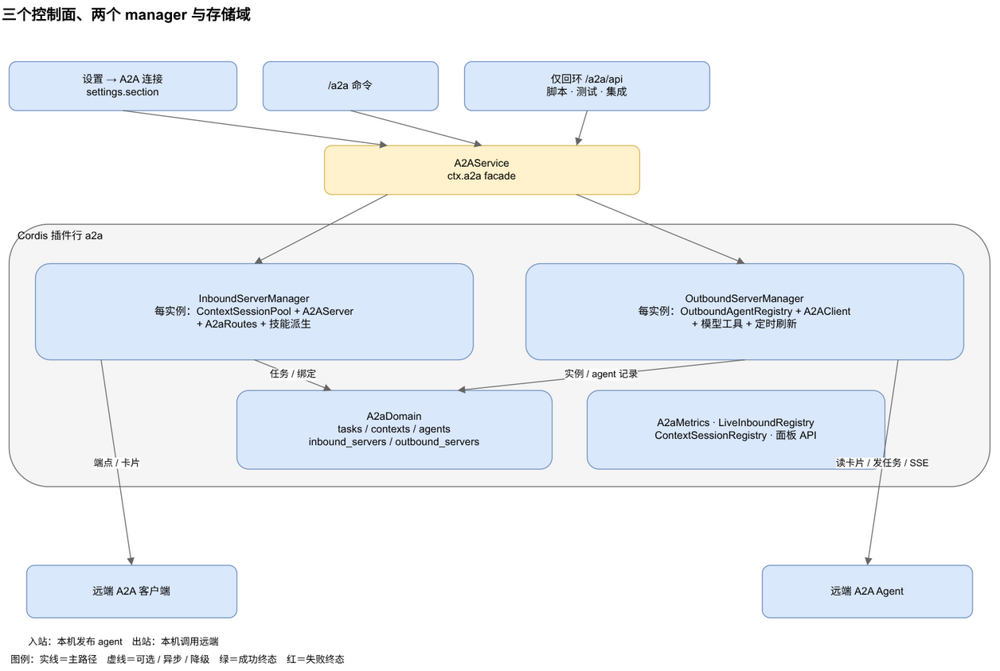

# dsh-a2a 中文深度手册

本手册面向源码阅读与线上运维，按架构、协议、运维、开发四个主题展开，和 `docs/` 下的分主题手册互补。图在 `img/`，draw.io 源文件在 `img/src/`。

`@hanphone/dsh-a2a` 是 DeepSeek Harness 的 Agent2Agent（A2A）v1.0.1 双端插件。它把本机的 DSH agent 发布成 A2A 端点，也把远端 A2A agent 的技能接成本机模型工具。两个方向都支持多实例，实例在设置页里创建、编辑、启停和删除，不写配置文件。

内容对应插件 `0.5.1` 与 DeepSeek Harness `0.2.1-rc.3`。代码与文档冲突时，以 `src/` 和 `tests/` 为准。

## 1. 两个方向

| 方向 | 谁调用谁 | 插件里的东西 |
|---|---|---|
| **入站** | 远端 A2A 客户端调用这个 DSH | 每个被发布的 agent 一个**入站 server** |
| **出站** | 这个 DSH 调用远端 A2A agent | 每张远端卡片一个**出站连接** |

两个方向互相独立。一个 profile 可以有任意多个入站与出站，可以指向其他 DSH 实例，也可以指向非 DSH 的 A2A agent。

`0.5.1` 起，入站输出只有一个口径：**只暴露可见的 assistant 文本**。工具调用、工具结果和 reasoning 留在 DSH 内部，不写进 artifact，也不回退成回复。一轮没有可见文本时，任务仍以 `TASK_STATE_COMPLETED` 结束，状态消息说明「没有可见输出」，而不是判失败。需要观察工具生命周期时，可以另开可选的 `dsh-trace/v1` 扩展；它只发 metadata（工具名、阶段、状态、耗时和脱敏参数摘要），不改变 artifact 与 history。

## 2. 三个控制面

| 控制面 | 用途 |
|---|---|
| **设置 → A2A 连接** | 主界面：实例 CRUD、启停、鉴权、对端/会话/任务查看 |
| **`/a2a` 命令** | DSH 聊天会话里的文字入口 |
| **仅回环 `/a2a/api`** | 脚本、测试与集成 |

三处调同一个 facade，状态不会互相矛盾。面板每 3 秒刷新快照。

## 3. 读哪一篇

| 你想知道 | 读 |
|---|---|
| 插件怎么挂上、入站任务怎么走、会话怎么绑定、数据落在哪 | [架构与任务链路](./architecture.md) |
| 面板 API 和 A2A 端点各暴露什么、SSE 怎么流、任务历史与可见性口径、可选 trace 扩展、状态与错误码 | [协议与接口](./protocol.md) |
| 面板和命令怎么用、实例怎么变、配置、存储、访问、故障怎么查 | [运维与排障](./operations.md) |
| 测试分几层、e2e 怎么跑、harness 换版本怎么验证 | [开发与兼容](./development.md) |

按角色：

- **第一次接触**：先看[架构与任务链路](./architecture.md)的前三节，再看[运维与排障](./operations.md)的面板部分。
- **只想跑起来**：直接看[运维与排障](./operations.md)的实例生命周期与配置，接口细节查[协议与接口](./protocol.md)。
- **要改代码**：架构、协议、开发三篇一起看，改宿主契约前先读兼容流程。
- **线上出问题**：从[运维与排障](./operations.md)的七步开始。

## 4. 版本与协议

- 插件：`@hanphone/dsh-a2a` `0.5.1`
- 已核对：DeepSeek Harness `0.2.1-rc.3`。e2e 矩阵还覆盖 `0.2.1-rc.2`、`0.2.1-alpha.2` 与 `0.1.7-rc.2`
- 协议：A2A `1.0.1` 的 JSON-RPC 绑定，声明协议版本 `1.0`
- 存储：`a2a` 域，默认走 profile 的 JSON 后端，可单独路由到 SQLite；任务记录保存 A2A 可见输入历史，可选 trace 摘要最多 64 条观察

## 5. 当前边界

- 只实现 JSON-RPC 绑定，没有 gRPC 与 HTTP+JSON。
- 入站只交付可见 assistant 文本；工具调用、工具结果和 reasoning 不进入 artifact 或 history。
- 没有 push notification、OAuth、mTLS 或按客户端凭据。
- 限流与并发配额是进程内、按实例或来源地址，不是分布式配额。
- SSE 事件日志在内存里，`Last-Event-ID` 只在同一进程的重连间有效。
- `dsh-trace/v1` 默认关闭（部署开关 `inboundTrace` 默认 `false`），必须同时满足部署开关、实例开关和请求头激活；它只在任务启动的请求上生效。
- trace 只发 metadata，参数摘要会脱敏并截断到 200 字符；任何能读任务的调用方都能看到 `Task.metadata` 里的摘要，只应对可信对端开启。`subagent` 执行器不观察子工具。
- 出站 `preset` 目前是持久化元数据，没有从它组装本地衔接会话。
- `subagent` 执行器存在，但默认技能表不选它。
- 进程死时处于 `TASK_STATE_WORKING` 的任务没有崩溃恢复。

## 6. 相关文件

| 文件 | 说明 |
|---|---|
| `README.md` / `README.zh.md` | 仓库根目录的安装与功能概览 |
| `docs/` | 本仓库的分主题手册（英文 / 中文） |
| `docs/extensions/dsh-trace/v1.md` | 可选 trace 扩展的 URI、字段、脱敏与边界 |
| `src/` | 宿主半区与浏览器半区 |
| `tests/` | 单元、组合、真实持久化与类型镜像 |
| `scripts/e2e-a2a.mjs` | 两实例 e2e |
| `cordis.patch.yml` | 插件挂载清单 |
