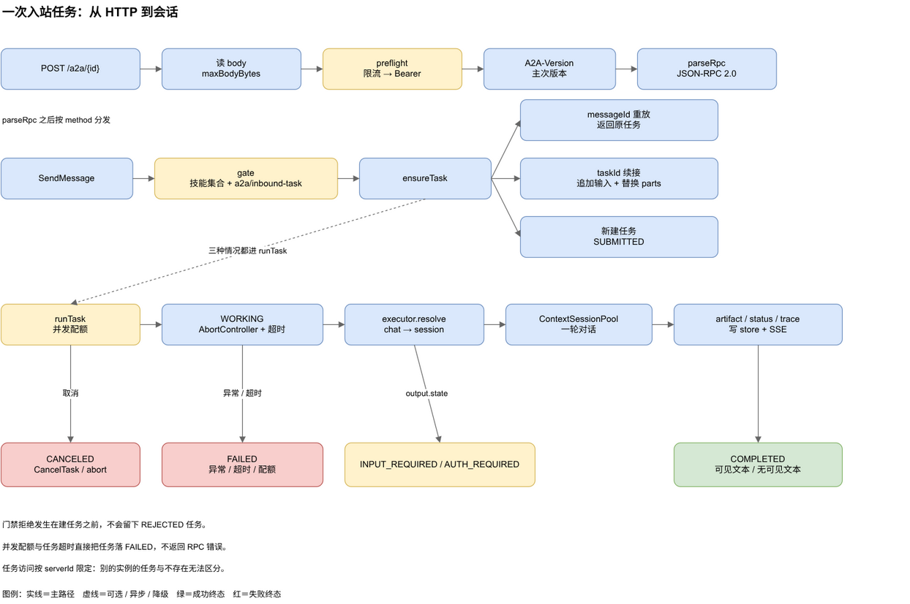
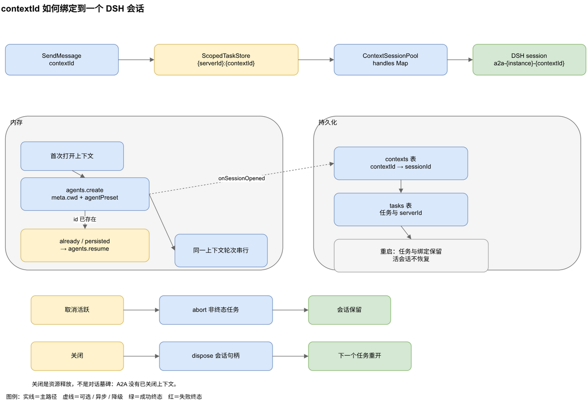
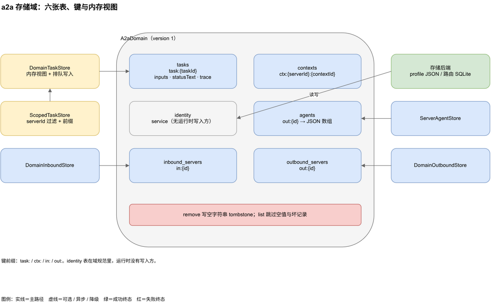

# 架构与任务链路

`@hanphone/dsh-a2a` 在 DeepSeek Harness 里只占一条 Cordis 行，id 是 `a2a`。它同时管两个方向：把本机的 DSH agent 发布成 A2A 端点，以及把远端 A2A agent 的技能注册成本机模型工具。两个方向共用一条插件生命周期，各有自己的 manager 和实例表。一个入站实例组装失败，不会影响已经连上的出站连接。

实例不写进 `cordis.patch.yml`。它们落在 `a2a` 存储域的 `inbound_servers` 与 `outbound_servers` 表里，由面板写入，重启时重新组装。

---

## 1. 一条插件行，两个 manager

`apply()` 做四件事：打开 `a2a` 域，构建 `InboundServerManager` 与 `OutboundServerManager`，注册 `ctx.a2a` facade，挂上面板 API 与可选的 `/a2a` 命令。返回的 disposer 会拆除所有实例并关闭域。

插件只注入 `storageDomain`。`webServer`、`agents`、`agentPresets`、`skills`、`credentials`、`subagents`、`attachments`、`tools`、`commands`、`agentDefaultModel` 都通过 `probeService` 探测。缺一个就把对应能力置空，插件本身仍然挂得上。逐项影响见[运维与排障：配置与宿主服务](./operations.md)。

`Config` 只承载宿主级默认值，实例级配置全部在域里。包本身不是 harness checkout 的 workspace 成员，`@deepseek-ai/*` 声明为 peer，`zod` 是唯一自有运行时依赖。构建产出宿主的 `lib/index.js` 与浏览器的 `lib/client.js`，浏览器 bundle 由 `scripts/build-client.mjs` 包成 `window.__ModuleLoader__.load` 契约。

| 路径 | 职责 |
|---|---|
| `src/index.ts` | 插件入口、`Config`、服务探测、manager 组装、面板路由、卸载 |
| `src/service.ts` | `ctx.a2a` facade，命令、面板与其他插件共用 |
| `src/api.ts` | 仅回环 `/a2a/api` 的快照、读取与控制动作 |
| `src/commands.ts` | `/a2a` 聊天命令 |
| `src/protocol.ts` | A2A 类型、方法名、任务状态、错误码、ProtoJSON 辅助 |
| `src/jsonrpc.ts` | JSON-RPC 2.0 帧与解析 |
| `src/servers/inbound-manager.ts` | 入站实例生命周期、技能派生、作用域存储 |
| `src/servers/outbound-manager.ts` | 出站实例生命周期、自动刷新、每实例 registry |
| `src/server/a2a-server.ts` | JSON-RPC 分发、任务生命周期、SSE、限流、鉴权 |
| `src/server/routes.ts` | HTTP 绑定、请求体上限、路由启停 |
| `src/server/card.ts` | 纯函数式 AgentCard 组装 |
| `src/server/store.ts` | `a2a` 域定义、`DomainTaskStore`、`MemoryTaskStore`、`ScopedTaskStore` |
| `src/server/trace.ts` | 可选 trace 扩展的 URI、schema 类型、脱敏与边界 |
| `src/server/exec/agent-runtime.ts` | 按上下文复用 DSH 会话、轮次串行、附件准入 |
| `src/server/exec/session.ts` | `session` 执行器 |
| `src/server/exec/subagent.ts` | `subagent` 执行器 |
| `src/server/executor.ts` | 执行器契约与技能到执行器的解析 |
| `src/server/session-registry.ts` | 会话视图聚合与 SSE 流计数 |
| `src/server/inbound-registry.ts` | 入站对端注册表 |
| `src/server/metrics.ts` | 进程内计数器与有界审计环 |
| `src/server/identity.ts` | 卡片身份重建辅助，当前只被单测引用 |
| `src/outbound/calls.ts` | A2A 客户端：卡片发现、发送、轮询、流式、取消、重试 |
| `src/outbound/registry.ts` | 已连接 agent、每实例视图、工具 disposer |
| `src/outbound/tools.ts` | 远端技能对应的模型工具 |
| `src/client/` | React 设置页、样式、更新状态格式化 |

---

## 2. 入站实例怎么组装

`InboundServerManager` 持有活跃实例集。每条 `InboundServerRecord` 在启动时组装成一个活实例：

- 端点路径 `endpointPath`，默认 `/a2a/<id>`，卡片路径是端点加 `/agent-card.json`；
- 有效 preset 取 `record.preset`，没有就用部署默认 `agentPresets.defaultId`；
- 该实例自己的 `ScopedTaskStore`、`A2AServer`、`A2aRoutes`；
- 挂载 `agents` 时的 `ContextSessionPool`；
- `ExecutorSet`、`LiveInboundRegistry`、`ContextSessionRegistry`；
- 生效的 trace 策略：部署配置 `inboundTrace` 是硬门禁，实例记录未设置时跟随它；只有生效时才在卡片宣告 `dsh-trace/v1`。

**技能是派生的，不填表单。** 添加、更新和启动时，插件用 preset 的 standing scope key（`agentPresets.standingKeyFor`）取 `ctx.skills.list({ scope })`，筛掉 `invocation.modelInvocable === false` 的条目，把剩下的映射成 `AgentSkill`，`id` 与 `name` 都取技能名。preset 或 skills 服务缺失、挂载失败、目录为空，都回退到内置的 `chat` 技能。

门禁分两步。先检查请求的技能在派生集合里，不在就拒绝。再把任务交给 `a2a/inbound-task` waterfall，监听者可以设置 `rejected.reason` 否决。每次判定都写一行日志，包含实例 id、技能名和拒绝原因。

路由注册是运行时的。`A2aRoutes.enable()` 注册两条路由：卡片走 `exact`，端点走 `prefix`。`disable()` 注销它们，记录和会话池都保留。

实例 id 由名称 slug 加 8 位随机十六进制组成，例如 `reports-1a2b3c4d`。出站 id 是 `out-` 加 12 位十六进制。

| 操作 | 行为 |
|---|---|
| `add` | 派生技能、解析 token、组装、持久化，按 `enabled` 注册路由 |
| `update` | 持久化 patch，重新派生技能与鉴权，换装活实例，保留原路由状态 |
| `setEnabled` | 注册或注销路由，持久化 `enabled` |
| `setAuth` | 写凭据、记录 token 名、重建实例，或清除 token 后匿名重建 |
| `remove` | dispose 活实例，向 `inbound_servers` 写空字符串 tombstone |

---

## 3. 一次入站任务的路径

`POST /a2a/<id>` 进来后，`A2aRoutes` 先按 `maxBodyBytes` 读请求体，超限返回 `413`，读失败返回 `400`。请求头 `Accept` 含 `text/event-stream` 时走 SSE 分支，否则走普通 JSON-RPC 分支。

两条分支都要过 `A2AServer.preflight`：先按来源地址做滑动窗口限流，超限返回 `429` 与 `Retry-After`，再校验 Bearer token，失败返回 `401` 与 `WWW-Authenticate: Bearer`。SSE 分支在写 `200` 之前完成这两步，所以鉴权失败仍然是干净的 HTTP 状态。

接着检查 `A2A-Version`。请求头或查询参数带版本时，只比较主次版本，不匹配返回 `VERSION_NOT_SUPPORTED`（`-32007`），响应头仍带 `A2A-Version: 1.0`。然后 `parseRpc` 解析 JSON-RPC 2.0，解析失败返回 `INVALID_REQUEST`。

`SendMessage` 先看 `configuration.acceptedOutputModes`。只接受文本模式，请求里排除文本会得到 `CONTENT_TYPE_NOT_SUPPORTED`。然后过门禁，再进 `ensureTask`。

`ensureTask` 分三种情况：

1. 消息带 `taskId`：任务必须属于本实例，`contextId` 必须一致。`messageId` 已经在这个任务上出现过就返回原任务，不重跑。任务已终态返回 `UNSUPPORTED_OPERATION`，任务还在跑也返回 `UNSUPPORTED_OPERATION`。都不是，就把这次消息追加到任务的可见输入历史（`inputs`），再把 `parts` 换成这次消息的内容，作为续接。
2. 消息不带 `taskId`，但 `messageId` 在任务库里出现过：返回原任务，不重跑。
3. 其余情况新建任务：`taskId` 为 `a2a-<uuid>`，`contextId` 取消息里的值或生成一个，技能取 `message.metadata.skill` 或 `chat`，状态 `TASK_STATE_SUBMITTED`，记录 `serverId` 与 `messageId`，并把首条消息连同补齐的 `contextId` 记成历史消息。

任务访问按 `serverId` 限定。别的实例的任务与不存在的任务返回同一个 `TASK_NOT_FOUND`，不泄露存在性。

`runTask` 先看并发配额。该实例正在跑的任务数达到 `maxConcurrentTasks` 时，新任务直接落 `TASK_STATE_FAILED`，状态消息是 `Inbound task concurrency quota exceeded`，不返回 RPC 错误。

配额通过后，任务进 `TASK_STATE_WORKING`，同时挂一个 `AbortController`。执行器按技能解析：默认 `session`，`chat` 也映射到 `session`。`subagent` 只有技能表真的绑到它、且 `ctx.subagents` 挂载时才可用，当前没有公开配置能选中。

执行期间，执行器通过 `onEvent` 上报三类事件。`status` 改任务状态并广播；`artifact` 追加或替换 artifact 并广播；`trace` 只在本次请求激活扩展时接收，追加一条有界摘要，并通过状态帧的 metadata 广播。`session` 执行器只把可见 assistant 文本增量写成 `result` artifact 的追加块，最后用 `lastChunk: true` 收尾。工具调用不再是 artifact。

执行结束分五种落点：

- 执行器返回可见文本：写一个 `result` artifact，任务落 `TASK_STATE_COMPLETED`。
- 执行器没有可见文本（例如这一轮只调用了工具）：不写 `result` artifact，任务仍落 `TASK_STATE_COMPLETED`，`status.message` 是 `The agent completed without visible output.`，并带 `metadata.reason = 'no-visible-output'`。这不是失败，也不会回退到 reasoning。
- 执行器返回 `state: INPUT_REQUIRED` 或 `AUTH_REQUIRED`：任务保持中断，状态消息取 `statusMessage` 或默认文案。
- 执行器抛异常：任务落 `TASK_STATE_FAILED`，错误码 `executor`，消息取异常文本。
- 超过 `inboundTimeoutMs`：`AbortController` 被中止，任务落 `TASK_STATE_FAILED`，错误码 `timeout`，消息写明预算毫秒数。

### 3.1 可见输出、任务历史与 trace

A2A 侧的 `Task.history` 不是 DSH 的完整逐轮 transcript，而是**这次任务里被接受的可见输入消息加最终输出**；没有可见输出时，最后一条是状态文本。每次续接输入都会先追加进 `inputs`，所以多次追问后历史仍按接受顺序保留。`SendMessage`、`SendStreamingMessage`、`GetTask`、`ListTasks` 的 `historyLength` 都裁剪这份历史，`0` 表示不返回，未设置表示不限制。

trace 是一条独立的 metadata 通道，激活链有五段：

1. 部署配置 `inboundTrace` 必须是 `true`，否则所有实例都不宣告、不产生 trace；
2. 实例记录允许 trace（未设置时跟随部署值），组装时把 `dsh-trace/v1` 写进 `AgentCard.capabilities.extensions`；
3. 请求带 `A2A-Extensions: <URI>`，服务端在同名响应头回显已激活的 URI；
4. `runTask` 把 `trace: true` 传给执行器，`session` 运行时监听 `session/event` 的 `tool/call` 与 `tool/result`；
5. 观察结果写进任务的 `trace` 摘要，并放进 `TaskStatusUpdateEvent.metadata[URI]`（实时）与 `Task.metadata[URI]`（落定后）。

trace 只含工具名、阶段、状态、耗时和脱敏后的参数摘要，每任务最多 64 条观察，摘要值截断到 200 字符。它**永远不会**进入 artifact、history 或出站工具输出。`subagent` 执行器不观察子工具事件。扩展只对启动任务的请求生效；`GetTask` 能读到已保存的摘要，但对已经跑起来的任务再发 `SubscribeToTask` 不会补开 trace。

取消走两条路。A2A 的 `CancelTask` 只接受非终态任务，终态任务返回 `TASK_CANCEL_NOT_ALLOWED`。面板和 facade 的 `abort` 直接中止执行器的 signal，把任务落 `TASK_STATE_CANCELED`，广播一次状态帧，然后唤醒等待者。两条路都幂等，已经取消的任务不会再次结算。

面板的测试控制台走 `sendTest`。它复用同一套门禁和任务生命周期，只跳过 HTTP 鉴权，因为它只在回环 API 上暴露。

---

## 4. 会话层与上下文绑定

一个 `(实例, contextId)` 对应一个 DSH 会话，会话 id 固定为 `a2a-<实例 id>-<contextId>`。实例 id 进 id 是为了让两个实例可以复用同一个客户端 `contextId` 而不共享会话。

`ContextSessionPool` 用 `agents.create` 打开会话，`meta` 里带工作目录与 `agentPreset`，`setup` 里调 `agentPresets.mount` 把 preset 挂上。如果会话 id 已经存在，`create` 会报错，错误文本匹配 `already has`、`already owns` 或 `persisted` 时改用 `agents.resume`。同一个上下文的并发打开由单飞表合并，只会创建一次。

同一上下文的多轮是串行的。每个上下文一条 Promise 尾链，后一轮等前一轮结束。返回值取本轮新增的 assistant 文本，不取会话全局的最后一条 assistant 消息。

轮次进行时，执行器监听 `agent/assistant-stream` 的 `text-delta`，把它转成 `result` artifact 帧；`tool-call-delta` 不再投影。`agent/error` 记下失败原因并在 `whenIdle()` 后抛出。返回值只取 assistant 消息里的文本 block，reasoning 等非 text block 被过滤，所以不会作为「最后一条回复」漏出去。发给 agent 的用户消息带 `source: { kind: 'a2a' }`，这是插件自己的来源类型，避免被 v4 会话编解码器当成已退役的共享 `plugin` 包装拒掉。

开启 trace 时，运行时另外监听 agent 作用域的 `session/event`：`tool/call` 记下 call id、工具名和开始时间，`tool/result` 按 call id 补结束状态与耗时；轮次结束时仍未收到结果的调用记成 `unknown`。这条监听只写摘要，不读工具结果内容。

附件在这里准入。文本与 data part 直接进 prompt，`raw` 的图片或文件走 `attachments.admitPromptContent` 换成持久引用。没有 attachments 服务时，原始附件退成可读占位符。URL-only 的 file part 不下载，按文本处理。

某个上下文的会话第一次打开时，`onSessionOpened` 把 `contextId → sessionId` 写进任务存储。`ScopedTaskStore` 给键加实例前缀，实际键是 `<serverId>:<contextId>`。写失败只记日志，不让任务失败。

`SessionView` 按 `(serverId, contextId)` 聚合。任务数、活跃数、首次与最近时间来自持久任务存储，`running` 表示至少有一个非终态任务，`streaming` 来自该实例的 SSE 打开计数，`live` 来自会话池是否真的持有句柄。所以重启后行还在，只是 `live` 为 false，没有 agent 循环的组合也能渲染这张表。

面板上的两个动作语义不同：

- **取消活跃**：中止该上下文所有非终态任务，会话句柄保留。
- **关闭**：先取消活跃任务，再 dispose 该上下文的会话句柄。下一个任务会重新打开一个新句柄。A2A 没有「已关闭上下文」这个概念，所以关闭不是墓碑。

`subagent` 执行器复用同一个会话池。它先用 `agentFor` 拿到父会话，再调 `ctx.subagents.start(provider, ...)` 起一个一次性子 agent，只把子 agent 输出里的文本 block 写成任务的 `result` artifact；没有可见文本时同样落 `COMPLETED` + 状态消息。子工具事件不提供 trace。

---

## 5. 存储域

`openDomain` 在 `storageDomain` 上打开 `a2a` 域，域版本是 `1`。六张表都是 `string -> string`，值统一是 JSON 字符串。

| 表 | 键 | 内容 |
|---|---|---|
| `tasks` | `task:<taskId>` | 任务记录，含来源实例 id、可见输入 history 与可选 trace 摘要 |
| `contexts` | `ctx:<serverId>:<contextId>` | `contextId → sessionId` 绑定 |
| `agents` | `out:<outboundId>` | 该出站实例的 agent 记录数组 |
| `identity` | `service` | 卡片身份字段。表在域规范里，当前没有运行时写入方 |
| `inbound_servers` | `in:<id>` | 入站实例记录 |
| `outbound_servers` | `out:<id>` | 出站实例记录 |

`DomainTaskStore` 在域之上保留一份内存视图。域写入是排队的，而 `TaskStore` 的同步读必须立刻看到自己的写入，所以它先改内存、再排队落盘，并且从不回读表。启动时它从 `tasks` 与 `contexts` 两张表把已有记录读进内存。

`ScopedTaskStore` 是每个入站实例看到的任务库。`get`、`list` 都按 `serverId` 过滤，`setState`、`appendArtifact`、`setParts`、`appendMessageId`、`appendInput`、`setStatusText`、`appendTrace` 先 `require` 再转发。上下文绑定也加前缀，避免两个实例共用同一个客户端 `contextId` 时串会话。

任务记录在原有字段之外还保存三样东西：`inputs`（A2A 可见输入消息，按接受顺序）、`statusText`（非错误的状态文本，例如「无可见输出」）和 `trace`（可选的 trace 摘要）。旧记录没有 `inputs` 时，读取历史的代码用当前 `parts` 补一条，升级不需要改域版本。任务记录会随 history 与 trace 增长：每条被接受的输入都保留，trace 最多 64 条观察，规划保留与备份策略时要算进去。

删除实例写的是空字符串，不是删键。`DomainInboundStore` 与 `DomainOutboundStore` 的 `list` 只解析非空且带 `in:` / `out:` 前缀的值，坏记录直接跳过。这样重启时 tombstone 不会把实例复活。

后端默认走 profile 的 JSON 存储。可以把 `a2a` 单独路由到 SQLite，配置见[运维与排障：存储、访问与升级](./operations.md)。

---

## 6. 出站半区

`OutboundServerManager` 为每条 `OutboundServerRecord` 建一个 `OutboundAgentRegistry`。每个 registry 有自己的 agent 存储，键是 `out:<id>`，值是该实例的 `OutboundAgentRecord` 数组，还有自己的工具 disposer 集合。

出站实例的字段比入站少：远端 AgentCard URL、本地名称、可选 preset、超时、可选 token 名、禁用技能、技能覆盖、启用标志、最近一次成功读卡时间。`preset` 目前只是持久化元数据，工具直接调用远端，没有从它组装本地衔接会话。

生命周期：

- `add` 先持久化记录，再连接。连接成功注册工具并写 `lastCardAt`。连接失败保留记录与一个 `failed` 视图，带 `lastError`，可以编辑或刷新。
- `boot` 为每条记录建 registry。已启用的实例异步 `loadAll` 连接并启动刷新定时器。启动时的连接失败只写日志，视图会落到 `disconnected`，不是 `failed`。
- `setEnabled` 对已连接的实例注销或重新注册工具。启动时就处于禁用状态的实例没有活连接，启用只改记录，需要保存一次编辑或重启才会真正连接。
- `refresh` 重读卡片并重建工具。
- `update` 持久化 patch，重建 registry，已启用就重新连接。
- `setAuth` 写凭据、更新 token 名、重建并重连。
- `remove` dispose 连接，向 `outbound_servers` 写 tombstone。
- 启用的实例按 `outboundRefreshMs` 定时刷新卡片，`0` 关闭定时器。

每个启用的远端技能注册成一个模型工具，名字是 `a2a__<连接名>__<技能 id>`，归一化到 `[A-Za-z0-9_-]`，最长 64 字符，重名时追加短哈希。工具参数只有两个：必填的 `prompt`，可选的 `taskId`。

工具发消息时总是请求流式。`A2AClient` 只有在远端卡片 `capabilities.streaming === true` 时才真的走 SSE，否则退回阻塞发送加轮询。调用方的 abort 会传给客户端，任务 id 已知时补发一次 `CancelTask`。传输错误与 5xx 最多重试 2 次。流式请求重试时带 `Last-Event-ID`，靠事件日志补上断点；调用方 abort 后不再重试。

远端任务失败时工具抛错，文本是 `Remote agent task failed: ...`。`INPUT_REQUIRED` 与 `AUTH_REQUIRED` 不抛错，返回带远端 `taskId` 的文本，模型可以拿这个 id 再调一次。渲染结果时优先取远端任务的 `result` artifact（它的 parts 原样作为结果）；没有时只取其余可见 artifact 的文本 part。非 result artifact 的 `data` part 与 trace/诊断 artifact 不会拼进模型可见结果，所以工具调用数据不会被误当成回复。没有可见输出时返回 `(remote agent returned no output)`。

工具用 `contextFor` 给每个调用方 agent 一个稳定的远端 `contextId`，同一进程内多轮工具调用落在同一个远端会话。这个映射只在内存里，重启后重新生成。

---

## 7. 浏览器半区与 facade

`src/client/` 通过 `ctx.slots.inject` 注册一个 `settings.section`，id 是 `a2a`，标题是 `A2A 连接`，排序 90。它只读写 `/a2a/api`，不含协议知识，也从不直接访问 A2A 端点。入站卡片在生效 trace 时显示 `trace` 徽标；创建与编辑表单有「允许 trace 扩展」复选框，默认关闭。

面板每 3 秒拉一次快照。版本条只在挂载时问一次更新，宿主把答案缓存 6 小时，只有点「检查更新」才带 `refresh=1` 重新联网。

样式写在 `dashboard.css.ts`，基于宿主的 `--dsw-alias-*` token，用 `@container` 做响应式。面板、`/a2a` 命令与其它插件读的 `ctx.a2a` 都调同一个 `A2AServiceImpl`，状态不会互相矛盾。

---

## 8. 相关文件

| 文件 | 说明 |
|---|---|
| `src/index.ts` | 插件入口与服务探测 |
| `src/servers/inbound-manager.ts` | 入站实例组装、技能派生、生命周期 |
| `src/server/a2a-server.ts` | JSON-RPC 分发、任务状态机、SSE |
| `src/server/exec/agent-runtime.ts` | 会话池、轮次串行、附件准入 |
| `src/server/store.ts` | 域定义与任务存储 |
| `src/server/trace.ts` | trace 扩展 URI、脱敏与上限 |
| `src/servers/outbound-manager.ts` | 出站实例生命周期 |
| `src/outbound/calls.ts` | A2A 客户端 |
| `src/outbound/tools.ts` | 模型工具注册 |
| `src/client/index.ts` | 设置页面板 |
| `tests/unit/a2a-server.spec.ts` | 任务生命周期、history、空输出、扩展激活与流式断言 |
| `tests/composition/composition.spec.ts` | 插件组装与多实例隔离 |
