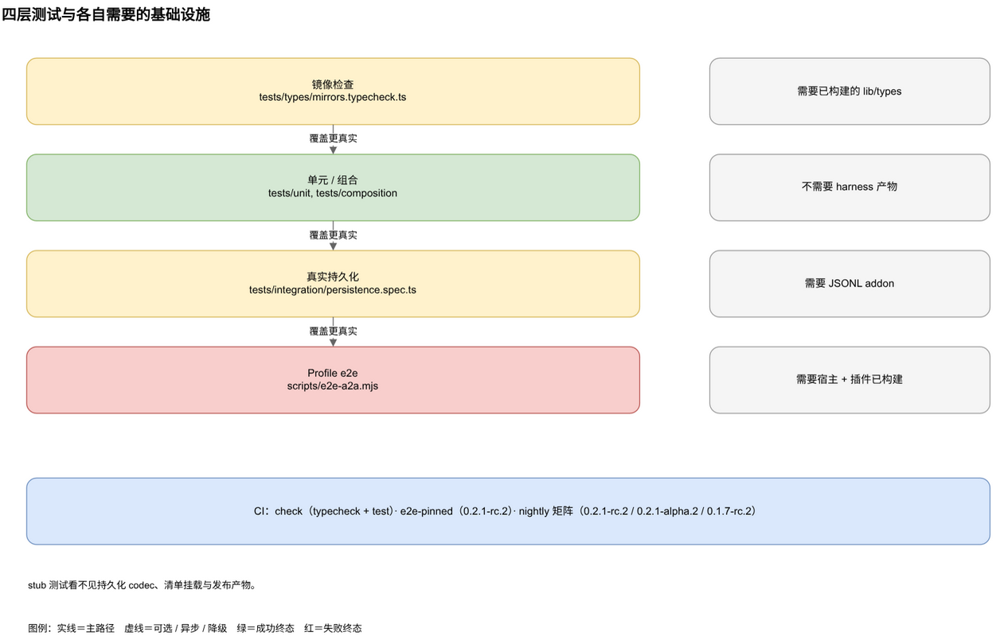
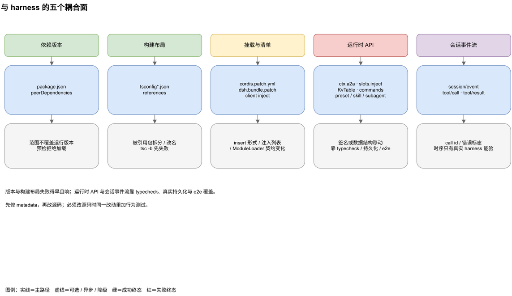

# 开发与兼容

插件可以全绿通过所有 stub 测试，仍然在真实 harness 上坏掉。测试分层就是为了让宿主契约的变化在发布前失败。另一半是兼容流程：插件针对兄弟目录里的 harness checkout 构建，不针对已发布包，每次换 harness 版本都要重新核对五个耦合面。

---

## 1. 测试分层与命令



| 层 | 位置 | 抓什么 | 需要已构建的 harness 产物 |
|---|---|---|---|
| 镜像检查 | `tests/types/mirrors.typecheck.ts` | 结构镜像与真实 `@deepseek-ai/dsh-*` 类型漂移 | 是，`lib/types` |
| 单元 / 组合 | `tests/unit`、`tests/composition` | 协议帧、路由、存储、注册表、`apply()` 在 stub 宿主服务上的接线 | 否 |
| 真实持久化集成 | `tests/integration/persistence.spec.ts` | 持久会话 codec、agent loop 契约、inbox 来源 | 是，JSONL addon |
| Profile e2e | `scripts/e2e-a2a.mjs` | 已发布产物对两个真实 harness 实例：清单与挂载、路由、发现、JSON-RPC、工具注册、模型到工具到远端 agent，以及 trace 卡片宣告与 header 回显 | 是，宿主与插件 |

可见性相关的覆盖在四个单测里：`tests/unit/agent-runtime.spec.ts`（reasoning 过滤与工具 trace 生命周期）、`tests/unit/a2a-server.spec.ts`（history、空输出、扩展激活）、`tests/unit/outbound-tools.spec.ts`（出站结果选取）、`tests/unit/subagent.spec.ts`（subagent 的 reasoning 过滤）。

命令：

```sh
pnpm typecheck        # 宿主 tsc -b + 客户端 + 镜像检查
pnpm test             # vitest：单元 + 组合 + 集成，196 项
pnpm test:integration # 只跑真实持久化（6 项）
pnpm build            # tsc + tsdown + 浏览器 bundle -> lib/
pnpm test:e2e         # 两实例 A2A 冒烟，需要先 build
pnpm test:all         # 以上全部
```

`pnpm test:e2e` 有两个前提：

- 已构建的插件。`lib/index.js` 不存在时会直接报错退出。
- 兄弟目录的 `../deepseek-harness` checkout，宿主产物已构建。`DSH_A2A_HARNESS_DIR` 可以改路径。
- 不需要别的。模型用 harness 自带的 mock LLM server。

`DSH_A2A_KEEP=1` 会保留两个临时 home、日志与子进程，方便排查。

---

## 2. hermetic e2e 与可视化测试

`scripts/e2e-a2a.mjs` 是 hermetic 且确定性的：

1. 两个临时 Harness home（`a` 与 `b`）各建一个 `web` profile，`a` 再加一个 `headless` profile。bundle 列表直接挂载已构建的插件，不走 registry，不碰用户 home。
2. 每个 home 起一个脚本化的 mock LLM server（`@deepseek-ai/dsh-llm-mock-server`），`dsh web` 用 `DEEPSEEK_BASE_URL` 与 `DEEPSEEK_API_KEY` 指向它。
3. **入站**：在 B 上创建允许 trace 的入站 server，确认卡片宣告 `dsh-trace/v1`；取 AgentCard，POST `SendMessage`（带 `A2A-Extensions`），断言 `result` artifact 是 mock 的文本、响应回显扩展头，且没有 `tool-call-*` artifact。
4. **出站**：在 A 上创建到 B 的出站连接，断言状态是 `connected` 且至少有一个工具。
5. **往返**：停掉 A 的 web 实例，用 A 的 `headless` profile 跑一个脚本化的 mock，让它调用 `a2a__b__chat`，断言 stdout 是 B 的回复，且远端任务没有泄漏工具 artifact。
6. 拆除两个 home 与所有子进程。

`pnpm visual:a2a` 起同一套 hermetic 双实例，额外提供一个交互式面板，打印回环地址。它显示两个实例、任务时间线、对端与会话，有两个按钮：

- **Inbound** 直接向 B 的端点发 `SendMessage`。
- **Outbound** 让 A 的 headless 模型按脚本调 `a2a__b__chat`，经 A2A 到 B。

它和 e2e 是同一套组合，只是可交互，用于演示和人工检查，不是 CI 门禁。`Ctrl+C` 会拆掉所有子进程与临时 home。

---

## 3. 加测试与 CI

加测试按改动类型分：

- **行为变更**：加一个单元或组合测试，去掉改动就失败。
- **新的宿主契约面**（运行时服务、消息形状、存储字段）：有结构镜像就扩镜像检查，只能端到端观察就加真实持久化或 e2e 断言。
- **新的 e2e 步骤**：加进 `scripts/e2e-a2a.mjs`，保持离线。默认运行只允许 mock LLM server。
- **可见性或 trace 变更**：断言空输出、reasoning 过滤、header 激活与 `Task.metadata` 边界，不能只看返回文本。

CI 在 `.github/workflows/ci.yml`：

- `check`：每次 push 与 pull request 跑 typecheck、单元、组合与真实持久化。
- `e2e-pinned`：对 `dsh-v0.2.1-rc.3` 跑 e2e。
- 夜间定时与手动 dispatch：对 peer 范围声称支持的每个 harness 版本跑 e2e 矩阵，当前是 `0.2.1-rc.3`、`0.2.1-rc.2`、`0.2.1-alpha.2`、`0.1.7-rc.2`。

放宽 `peerDependencies` 的同一个改动里要同步放宽矩阵，并把结果记进兼容记录。

---

## 4. 五个耦合面



| 面 | 位置 | harness 变化会怎样 |
|---|---|---|
| 依赖版本 | `package.json` 的 `peerDependencies` | DSH peer 范围不再覆盖运行版本，预检拒绝加载插件 |
| 构建布局 | `tsconfig.json`、`tsconfig.client.json`、`tsconfig.types.json` 的 `references` | 被引用的包拆分、改名或不再是 composite，`tsc -b` 在读源码前就失败 |
| 挂载与清单契约 | `cordis.patch.yml`、`dsh.bundle.patch`、`dsh.client.inject`、`scripts/build-client.mjs` | `- insert:` 形式、客户端注入列表或 `window.__ModuleLoader__.load({ id, factory })` 契约变化 |
| 运行时 API | `ctx.a2a`、`ctx.slots.inject('settings.section', …)`、存储 `KvTable`、commands、preset/skill/subagent 数据 | 消费的服务签名或数据结构移动 |
| 会话事件流 | `src/server/exec/agent-runtime.ts` 对 `session/event` 的 `tool/call` / `tool/result` 监听 | trace 观察丢失 call id、错误标志或事件时序；只有真实 harness 证据能抓到 |

顺序按检查成本排：版本与构建布局失败得早且响，运行时 API 与会话事件流靠消费方 typecheck、真实持久化与 e2e 覆盖。会话事件流是 `0.5.1` 新增的一面：`pnpm test` 里的 stub 事件顺序正确，不代表真实 harness 会按同样顺序发 `tool/call` 与 `tool/result`。

---

## 5. 换版本流程

### 5.1 定位 harness 版本

harness 没有 changelog，版本看根 `package.json` 的 `version`，发布 tag 是 `dsh-v<semver>`。

```sh
cd ../deepseek-harness
grep -m1 '"version"' package.json
git status -sb && git log --oneline -3
git fetch origin --tags --prune
git ls-remote --tags origin | grep -v '\^{}' | awk -F/ '{print $NF}' | sort -V | tail -10
```

`git ls-remote` 看的是上游，不受本地已 fetch 的 tag 限制。只看本地 tag 列表可能落后好几个版本线。

### 5.2 刷新 harness 构建

harness 的 `lib/` 是 gitignore 的，切版本后旧产物还在。陈旧的产物会让插件对着上一个版本做 typecheck。切版本也可能留下没有清单的包目录，被宿主 workspace 的 glob 扫到。

```sh
pnpm install --frozen-lockfile
pnpm run clean
pnpm run build
```

### 5.3 比对耦合面

```sh
cd ../deepseek-harness
git diff <from> <to> -- vendor/cordis vendor/schemastery | head -40
git diff <from> <to> -- packages/client/ui-settings packages/storage packages/interaction | head -40
git diff <from> <to> -- tsconfig.base.json tsconfig.base.client.json tsconfig.client.json tsconfig.host.json
```

### 5.4 对新 checkout 验证

```sh
cd ../dsh-a2a
pnpm typecheck   # 宿主 + 客户端 + 镜像检查
pnpm test        # 单元 + 组合 + 真实持久化
pnpm build       # tsc + tsdown + scripts/build-client.mjs
pnpm test:e2e    # 已构建产物的两实例 A2A 冒烟
```

`pnpm test` 单独不足以证明兼容：它跑在 stub 宿主服务上，看不见持久化 codec 或清单与挂载漂移。能看见的是镜像检查与 e2e。

如果删了 `lib/` 重建却没动作，多半是 TypeScript 构建缓存还在。先清 `node_modules/.cache/dsh-a2a/`。`tsc -b` 相信陈旧的 tsbuildinfo，tsdown 随后找不到入口。

### 5.5 先改 metadata，再改源码

优先修项目引用、peer 范围或版本号。必须改源码时，同一个改动里加或调行为测试。

---

## 6. peer 预检、记录与发布

DSH 0.1.7 起会在导入前按运行版本评估插件的 `@deepseek-ai/dsh` 与 `@deepseek-ai/dsh-*` peer。预发布版本也参与范围匹配，`workspace:^`、`~`、`*` 指向运行版本。拒绝时带 `incompatible-version` 码与不满足的范围，插件管理器在 pnpm 运行前就拒绝 registry 安装。

预检忽略 `@deepseek-ai/cordis` 与 `@deepseek-ai/schemastery`。只有 `@deepseek-ai/dsh-commands` 与 `@deepseek-ai/dsh-storage-domain` 参与。这两个范围要对每个测过的 harness 版本说真话。另外两个虽然不评估，声明范围仍要容纳宿主 vendored 的副本，包括宿主线 vendored 的精确预发布版本。

真要绕过一次不匹配，给精确豁免，不要放宽范围：

```sh
dsh plugin allow-version <pkg@version> --dsh-version <runtime> --accept-risk
dsh plugin version-exemptions
dsh plugin revoke-version <pkg@version> --dsh-version <runtime>
```

记录、提交、打包：

- 同一个 commit 里 bump `package.json` 的 `version`。
- 提交消息写清验证过的 harness 版本。
- 产出 tarball：

```sh
pnpm pack --pack-destination <dir>
```

发布到 npmjs，包名 `@hanphone/dsh-a2a`，`publishConfig.access: public`。发布时的 `403` 是 npm 凭据问题，不是包的问题。没有明确要求就不发布。

`0.5.1` 已对 harness `0.2.1-rc.3` 验证：`pnpm typecheck`（宿主、客户端、镜像检查）、`pnpm test`（196/196）、`pnpm test:integration`（6/6）、`pnpm build` 产出 `lib/index.js` 与 `lib/client.js`、`pnpm test:e2e` 在两个真实实例上跑通入站与出站往返，并验证 trace 扩展的卡片宣告与 header 回显。`0.2.1-rc.2` 仍在矩阵中；`0.2.1-alpha.2` 与 `0.1.7-rc.2` 由定时矩阵覆盖。

---

## 7. 已知陷阱与限制

陷阱：

- **`tsc -b` 看起来成功，`lib/` 是空的。** 陈旧 tsbuildinfo，清 `node_modules/.cache/dsh-a2a/`。
- **客户端 typecheck 读到旧声明。** harness 的 `lib/types` 是 gitignore 的，checkout reset 后还在。切版本后重建被引用的包。
- **残留的无清单 harness 包目录。** 重建前在 harness 里跑 `pnpm run clean`。否则 tsdown 的 `packages/*/*` glob 会打包残留的 `lib/types`，报 `MISSING_EXPORT`。
- **两份 zod。** `dependencies.zod` 钉在 harness 的线上（`~4.4.3`）。浮动的 `^4.4.3` 在 `exactOptionalPropertyTypes` 下会给出互不兼容的 `Config` 类型。
- **每个脚本前都报 `ERR_PNPM_NO_MATCHING_VERSION`。** harness peer 在真实范围里没有 registry 版本。pnpm 11 以上从 `pnpm-workspace.yaml` 读 `autoInstallPeers: false` 与 `verifyDepsBeforeRun: false`，只配 `.npmrc` 不够。
- **solution reference 报 TS6306。** 暴露 solution `tsconfig.json` 的 harness 包要通过它的 `tsconfig.client.json` 或 `tsconfig.host.json` 叶子引用。
- **测试里 import harness 源码报 Vite `SyntaxError`。** harness 源码用标准 TypeScript 装饰器，`vitest.config.ts` 装了 harness 的 `standardDecoratorPlugin`。
- **spec 的 import 找不到 harness 路径映射。** Vite 8 的原生 `resolve.tsconfigPaths` 只对 tsconfig include 的文件应用 `paths`。`tests/tsconfig.json` 继承构建配置并 include spec。

限制：

- 还没有对 harness 正式版做过验证，当前验证过的都是预发布版本。
- 插件通过路径耦合 `../deepseek-harness`。checkout 在别的相对路径时，要改 `tsconfig*.json` 的 references。

---

## 8. 相关文件

| 文件 | 说明 |
|---|---|
| `tests/types/mirrors.typecheck.ts` | 结构镜像检查 |
| `tests/integration/persistence.spec.ts` | 真实持久化集成 |
| `tests/unit/agent-runtime.spec.ts` | 可见文本、reasoning 过滤与 trace 生命周期 |
| `tests/unit/outbound-tools.spec.ts` | 出站结果选取 |
| `scripts/e2e-a2a.mjs` | 两实例 e2e |
| `scripts/visual-a2a-test.mjs` | 交互式双实例面板 |
| `vitest.config.ts` | 测试配置与装饰器插件 |
| `tsconfig.json` / `tsconfig.client.json` / `tsconfig.types.json` | 项目引用 |
| `cordis.patch.yml` | 插件挂载清单 |
| `scripts/build-client.mjs` | 浏览器 bundle 包装 |
| `.github/workflows/ci.yml` | CI 与 e2e 矩阵 |
