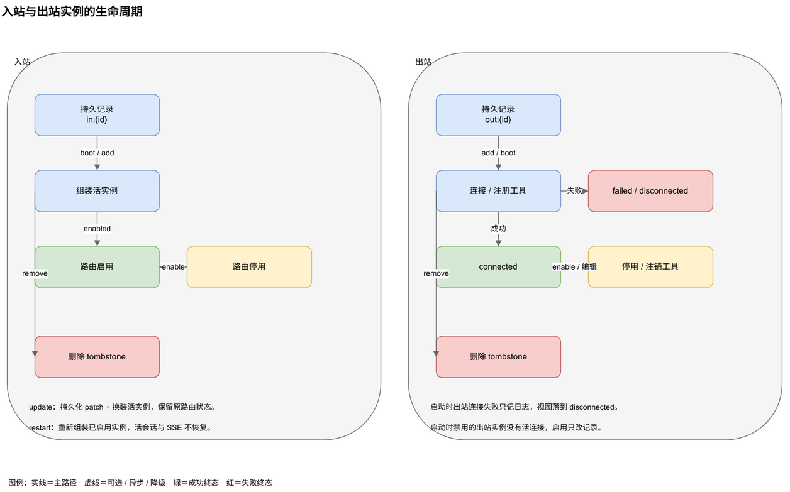
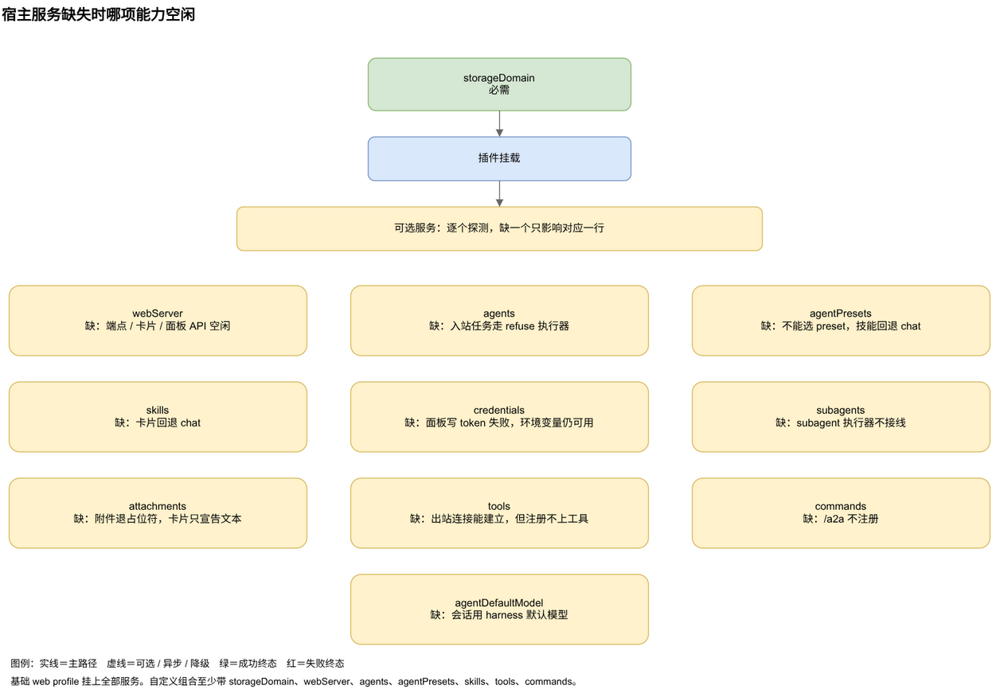
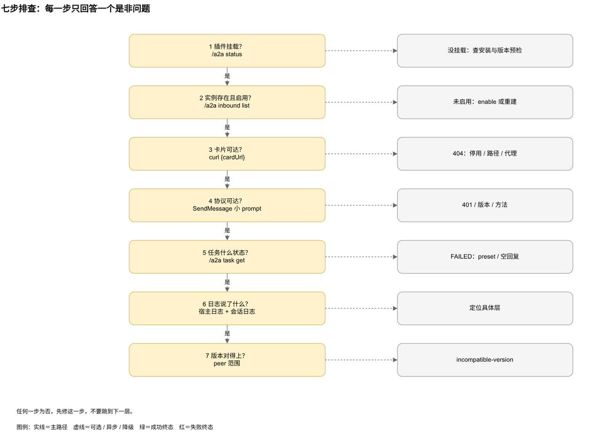

# 运维与排障

插件有三个控制面，调的是同一套 facade。面板适合日常操作，`/a2a` 命令适合在聊天里快速看状态，仅回环的 `/a2a/api` 适合脚本和集成。实例存在 `a2a` 存储域里，不写配置文件，重启后重新组装。

---

## 1. 控制面与面板

| 控制面 | 用途 |
|---|---|
| **设置 → A2A 连接** | 主界面：创建、编辑、启停、删除，查看对端、会话与任务 |
| **`/a2a` 命令** | DSH 聊天会话里的文字备份 |
| **仅回环 `/a2a/api`** | 脚本、测试与集成，接口见[协议与接口](./protocol.md) |

面板每 3 秒刷新一次快照。

### 1.1 版本与更新条

面板顶部显示已安装插件版本、Node 运行时和更新检查结果。检查同时问 npm registry 与 `package.json` 里的 GitHub 仓库，取较高版本，结果是三者之一：已是最新、有新版本、无法检查。查询失败不会显示成「已是最新」。

答案缓存 6 小时，点「检查更新」会带 `refresh=1` 强制重查。发现新版本时，面板给出当前 profile 的两步更新命令（先 `remove` 再 `add`）和复制按钮。检查是只读的，不安装、不重启、不改 profile。

入站卡片显示实例宣告的版本，出站卡片在连接后显示远端卡片版本。

### 1.2 入站 Servers

每张卡片显示名称、端点路径、preset、鉴权状态、派生技能、卡片 URL，以及生效 trace 时的 `trace` 徽标。操作：

| 操作 | 效果 |
|---|---|
| **启用 / 停用** | 注册或注销卡片与端点路由，记录与会话池保留 |
| **Card** | 打开当前 AgentCard JSON |
| **测试** | 走内置测试控制台，同一套门禁与任务生命周期，跳过 HTTP 鉴权 |
| **编辑** | 改名称、描述、版本、preset 或 token，重新派生技能并换装活实例 |
| **删除** | dispose 活实例并删除持久记录 |
| **清除鉴权** | 只出现在已配鉴权的实例上，删除 token 后匿名重建 |

创建与编辑表单有名称、版本、preset、Bearer token、描述，以及「允许 trace 扩展（工具名/脱敏摘要，默认关闭）」复选框。技能在创建后显示，不用填。preset 选择器列出真实名单，并预选部署默认。部署配置 `inboundTrace: false` 时复选框不会让 trace 生效，卡片也不会宣告扩展。

测试控制台选一个实例、技能、可选 `contextId` 和消息，返回任务 JSON。

### 1.3 出站 Servers

添加分两步：

1. 填远端 AgentCard URL 与可选 token，点「导入」。
2. 核对发现的名称、版本、描述、端点与技能，调整本地名称、preset、超时，点「连接」。

连接后的卡片显示状态点、远端版本、导入技能数、工具数与失败时的 `lastError`。操作：

- **启用 / 停用**：给活连接注销或重新注册工具。启动时处于禁用状态的实例没有活连接，启用只改记录，要保存一次编辑或重启才会连接。
- **刷新**：重读卡片并重建工具。
- **编辑**：改名称、preset、超时、token 与逐技能启用状态。远端卡片 URL 不能在编辑里改，换 URL 要删掉重建。
- **删除**：dispose 连接并删除记录。

编辑表单可以禁用单个技能，也接受 JSON 的 `skillOverrides`，例如 `{"chat": {"name": "...", "description": "..."}}`。

token 通过 credentials 服务保存。token 输入框留空表示保留原值。入站表单有「清除鉴权」，出站表单没有清除按钮，要通过 `outbound.setAuth` 发空 token 清除。

### 1.4 连接与任务

活动页先给计数器与审计表（最近 20 条），再给三张表：

- **入站连接**：谁在调用本服务，来源、任务数与活跃数、首次与最近时间、关闭。
- **入站会话**：每个 `(实例, contextId)` 一行，实例、preset、运行中或空闲、任务数与活跃数、流式标记、首次与最近时间、取消活跃、对话、关闭。
- **任务**：每页 50 条，可按状态筛选，可加载更多。单条任务 JSON 通过 `/a2a/api/task?id=` 读取。

三个动作的语义：

- **取消活跃**：中止该上下文所有非终态任务，会话保留。
- **关闭会话**：先取消活跃任务，再释放该上下文的活会话句柄。下一个任务会重开新句柄，关闭不是对话墓碑。
- **关闭连接**：取消该对端的活跃任务并删除对端记录，不删任务记录。

---

## 2. `/a2a` 命令

命令在 DSH 聊天会话里可用。列表与状态动词输出 JSON。

| 命令 | 用途 |
|---|---|
| `/a2a status` | 整个插件的快照 |
| `/a2a presets` | agent preset 名单 |
| `/a2a inbound list` | 入站实例 |
| `/a2a inbound create <name> [preset] [description]` | 创建入站实例 |
| `/a2a inbound remove <id>` | 删除入站实例 |
| `/a2a inbound enable\|disable <id>` | 启停路由 |
| `/a2a outbound list` | 出站实例 |
| `/a2a outbound create <agentCardUrl> [name] [preset]` | 创建出站连接 |
| `/a2a outbound remove <id>` | 删除出站连接 |
| `/a2a outbound enable\|disable <id>` | 启停出站连接 |
| `/a2a outbound refresh <id>` | 重读远端卡片 |
| `/a2a tasks` | 最近 50 条任务 |
| `/a2a task get <taskId>` | 一条任务 |
| `/a2a task cancel <taskId>` | 取消任务 |
| `/a2a sessions` | 按上下文的会话视图 |
| `/a2a session cancel <contextId>` | 取消上下文的活跃任务 |
| `/a2a session close <contextId>` | 释放上下文的活会话 |
| `/a2a peers` | 入站对端注册表 |
| `/a2a help` | 用法 |

参数按空白分隔。入站描述取 preset 之后剩余的词。命令创建的入站版本固定为 `1.0.0`，不能设 token 或自定义端点路径，这些字段用面板或 HTTP API。

---

## 3. 实例生命周期



**入站**

- **创建**：持久化记录，派生技能，解析 token，组装运行时，按 `enabled` 注册路由。
- **更新**：持久化 patch，重新派生技能（preset 可能变了），重新解析 token，换装活实例，保留原路由状态。
- **启用 / 停用**：注册或注销路由，持久化 `enabled`。记录、技能与会话池都保留，停用的实例在启动时仍会组装，只是不注册路由。
- **删除**：dispose 活实例，向 `inbound_servers` 写空字符串。实例不会在重启后复活。
- **重启**：重新组装所有持久化实例，已启用的注册路由。活会话与 SSE 订阅不恢复。

**出站**

- **添加**：先持久化记录，再连接。连接成功写 `lastCardAt` 并注册工具。失败保留记录与 `failed` 视图。
- **启动**：为每条记录建 registry。已启用的异步连接并启动刷新定时器。启动时连接失败只写日志，视图显示 `disconnected`，不是 `failed`。
- **启用 / 停用**：对活连接注销或重新注册工具，并持久化标志。
- **刷新**：重读卡片并重建工具。
- **编辑**：持久化 patch，重建 registry，已启用就重新连接。
- **设置 token**：写凭据、更新 token 名、重建并重连。
- **删除**：dispose 连接，向 `outbound_servers` 写空字符串。
- **重启**：重新组装记录，已启用的重新连接。活连接不恢复。

---

## 4. 配置与宿主服务

实例不在 `cordis.patch.yml` 里。插件 `Config` 只放宿主级默认值，通过 profile 的用户 patch 层覆盖，路径是 `$DSH_HOME/profiles/<name>/cordis.patch.yml`：

```yaml
- id: a2a
  config:
    baseUrl: http://127.0.0.1:3080
    subagentProvider: in-process
    defaultTimeoutMs: 60000
    inboundTimeoutMs: 600000
    requestsPerMinute: 120
    maxConcurrentTasks: 32
    maxBodyBytes: 1048576
    outboundRefreshMs: 300000
    inboundTrace: false
```

| 字段 | 默认值 | 含义 |
|---|---|---|
| `baseUrl` | web server 端口，再退 `DSH_A2A_PORT`，再退 `3000` | 每张入站 AgentCard 宣告的 base URL |
| `subagentProvider` | `in-process` | subagent 执行器的 provider 名 |
| `defaultTimeoutMs` | `60000` | 出站连接的默认单次调用超时 |
| `inboundTimeoutMs` | `600000` | 每任务入站执行预算，超时落 `FAILED`，`0` 关闭 |
| `requestsPerMinute` | `120` | 每个入站来源的滑动窗口请求上限，超限 `429`，`0` 关闭 |
| `maxConcurrentTasks` | `32` | 每个入站实例的并发任务上限，超配额任务失败，`0` 关闭 |
| `maxBodyBytes` | `1048576` | 入站 A2A 请求体上限 |
| `outboundRefreshMs` | `300000` | 已启用出站连接的卡片自动刷新间隔，`0` 关闭 |
| `inboundTrace` | `false` | 可选 trace 扩展的部署总开关与实例默认值；为 `false` 时任何实例都不能激活 |

入站会话的工作目录是 `$DSH_HOME/a2a-sessions`，启动时创建。`DSH_HOME` 默认是 `~/.dsh`。

只有 `storageDomain` 是必需的。其余服务探测失败时，对应能力空闲：



| 服务 | 使用方 | 缺失时 |
|---|---|---|
| `storageDomain` | 两个方向 | 必需，插件不挂载 |
| `webServer` | 入站路由、面板 API | 入站端点、卡片与面板 API 空闲 |
| `agents` | 入站会话执行器 | 入站任务交给直接报错的 `refuse` 执行器 |
| `attachments` | 入站图片与文件 part、输入模式宣告 | 原始附件退成占位符，卡片只宣告文本 |
| `agentPresets` | preset 选择、技能派生 | 不能选 preset，派生技能回退 `chat` |
| `skills` | 技能派生 | 卡片回退 `chat` |
| `credentials` | token 存取 | 面板写 token 失败，外部环境变量仍可用 |
| `subagents` | subagent 执行器 | 不接线 subagent 执行器 |
| `agentDefaultModel` | 入站会话的模型选项 | 会话用 harness 默认值 |
| `tools` | 出站工具注册 | 出站连接能建立，但注册不上工具 |
| `commands` | `/a2a` | 聊天命令不注册 |

基础 `web` profile 会挂上全部服务。自定义组合至少要带 `storageDomain`、`webServer`、`agents`、`agentPresets`、`skills`、`tools`、`commands`，再按能力加 `attachments`、`credentials`、`subagents`、`agentDefaultModel`。trace 依赖 `agents` 与 harness 的 `session/event`；没有 agent 循环时不会有工具观察。

---

## 5. 存储、访问与升级

### 5.1 存储

持久状态都在 `a2a` 域：

| 表 | 内容 |
|---|---|
| `tasks` | 任务记录，含来源实例 id、A2A 可见输入 history、状态文本与可选 trace 摘要 |
| `contexts` | `contextId → sessionId` 绑定 |
| `agents` | 每个出站实例的 agent 记录，键 `out:<id>` |
| `identity` | 卡片身份字段。表在域规范里，当前没有运行时写入方 |
| `inbound_servers` | 入站实例记录，键 `in:<id>` |
| `outbound_servers` | 出站实例记录，键 `out:<id>` |

默认走 profile 的 JSON 后端。只把 `a2a` 路由到 SQLite：

```yaml
- id: storage-domain
  config:
    backend: json
    routes:
      a2a: sqlite
- insert:
    - id: storage-sqlite
      name: '@deepseek-ai/dsh-storage-sqlite'
      config:
        path: /absolute/path/to/a2a.sqlite
```

运维注意：

- **一个 `DSH_HOME` 一个写者。** 两个 DSH 进程共用一个 home 会写同一个 JSON 域，互相覆盖实例与任务。两实例测试要用不同的 home 和端口。
- **任务与实例持久，活会话不持久。** 流订阅、对端注册表也在内存里，重启清空。
- **任务记录会随 history 与 trace 增长。** 每条被接受的输入都会为 `Task.history` 保留；可选 trace 摘要最多 64 条观察。大附件与长续接会放大域记录体积，规划保留与备份策略时要算进去。
- **域里存的是 JSON 字符串。** 格式变化由域的 `version` 字段守护。新增字段是可选的，旧任务记录缺少 `inputs` 时会用当前 `parts` 补一条，升级不需要迁移脚本。升级前仍建议备份 JSON 或 SQLite 文件。
- **会话日志**由 DSH 自己的会话持久化写在 `$DSH_HOME/sessions/...`，插件的工作目录是 `$DSH_HOME/a2a-sessions`。

### 5.2 访问与安全

- **面板 API 只回环。** `/a2a/api` 只接受 `127.0.0.1`、`::1`、`::ffff:127.0.0.1`，其它来源 `403`。放到反向代理后面也不会变成远程可调用。
- **A2A 端点跟 GUI 共用 web server。** 把这个 server 暴露到网络时，每个入站实例都要配 Bearer token，并在代理层终止 TLS。插件不加 TLS，请求、请求体与并发限制都是进程内，不是分布式配额。
- **token 是凭据引用。** 面板通过 `ctx.credentials.set` 写入，名字是 `A2A_INBOUND_<ID>` 或 `A2A_OUTBOUND_<ID>`，大写，非字母数字换成 `_`。记录只留名字，卡片只留方案，面板不回显值。解析发生在实例组装时，先读 credentials 服务，再读进程环境。
- **入站鉴权。** 配了 token 后每个请求都要 `Authorization: Bearer <token>`，否则 `401` 带 `WWW-Authenticate: Bearer`。流式请求在 `200` 之前鉴权。
- 每个入站实例用不同 token，一个泄露不会打开所有已发布 agent。面板改 token 会立刻重建该实例，外部导出的环境变量要等下次组装才生效。
- **trace 默认关闭，且只发 metadata。** 部署 `inboundTrace` 是硬门禁，实例还要允许，调用方还要用 `A2A-Extensions` 请求。它只含工具名、阶段、状态、耗时和脱敏参数摘要；原始参数、工具结果与 reasoning 永不包含。任何能读任务的调用方都能看到 `Task.metadata` 里的摘要，只对可信对端开启。关闭部署开关并重载或重启后，所有卡片都会移除该扩展。
- 没有 OAuth、mTLS 或按客户端凭据模型。

### 5.3 升级与卸载

```sh
dsh plugin --profile web add @hanphone/dsh-a2a@latest
```

装完重启 `dsh web`。实例与任务在域里，升级后还在，活会话不保留。

```sh
dsh plugin --profile web remove @hanphone/dsh-a2a
```

卸载插件不会删 `a2a` 域数据。要丢弃实例定义与任务历史时，再删域记录或存储文件。

---

## 6. 排障顺序



按顺序走，每一步缩小一层：

1. **插件挂载了吗？** `/a2a status` 能返回快照。
2. **实例存在且启用吗？** `/a2a inbound list` 与 `/a2a outbound list`。
3. **卡片可达吗？** `curl <cardUrl>`。
4. **协议可达吗？** 用一个很小的 prompt 发 `SendMessage`。
5. **任务什么状态？** `/a2a tasks`、`/a2a task get <id>`。
6. **日志说了什么？** DSH 宿主日志，会话问题再看 `$DSH_HOME/sessions` 下对应 `a2a-<实例>-<contextId>` 的日志。
7. **版本对得上吗？** 见下面的 `incompatible-version`。

---

## 7. 常见故障对照

### 7.1 任务完成但没有可见回复

任务处于 `TASK_STATE_COMPLETED`，`status.message` 是 `The agent completed without visible output.`，表示这一轮正常结束，但没有产生可见的 assistant 文本（例如只调用了工具）。这不是失败，也没有 `result` artifact，更不会回退到 reasoning。用 `/a2a task get <taskId>` 读任务与状态消息。

如果预期有文本，逐项排查：

1. 在活动页的入站会话里找这个 `contextId`，看是运行中还是空闲。
2. 检查 preset 的模型 provider。未认证或配错的 provider 会产出空 assistant 消息，用同一个 preset 开一个普通 DSH 会话对照。
3. 看宿主日志里的 `a2a` 警告，以及 `$DSH_HOME/sessions/...` 下 `a2a-<实例>-<contextId>` 的会话日志。

真正的 provider 或执行器错误仍会落为 `TASK_STATE_FAILED`，状态消息携带错误。任务如果是 `TASK_STATE_CANCELED`，是调用方或面板取消的；在同一个上下文上发新任务会重开会话。

### 7.2 入站请求返回 401

实例配了 token，请求没对上。

- 带 `Authorization: Bearer <token>`。
- token 在实例组装时读取（add、update、boot、setAuth），先 credentials 服务，再进程环境。检查托管名：
  - 入站：`A2A_INBOUND_<ID>`，大写，非字母数字换成 `_`；
  - 出站：`A2A_OUTBOUND_<ID>`。
- 入站卡片会显示是否配了鉴权。用「编辑」换 token，或「清除鉴权」去掉。
- 流式请求在 `200` 之前鉴权，`401` 是干净的 HTTP 状态，不是坏掉的流。

### 7.3 卡片 404 或连接被拒

- 实例可能被停用。`/a2a inbound list` 与面板都显示启用状态，启用后重试。
- 用面板给出的 per-instance 卡片路径 `/a2a/<id>/agent-card.json`。实例不使用 `/.well-known/agent-card.json`。
- 确认 web server 监听在调用的地址上：

```sh
curl -v http://127.0.0.1:3080/a2a/<id>/agent-card.json
```

- 如果走公网或反向代理，确认代理转发 `/a2a/` 前缀，并保留 web app 期望的 `Host` 头。

### 7.4 出站连接是 failed

面板显示 `lastError`，常见原因：

| 现象 | 检查 |
|---|---|
| `HTTP 401` | 远端要 token，编辑连接并设置 |
| `HTTP 404` | 卡片 URL 错了，用远端完整的 per-instance 卡片路径 |
| `invalid agent card` | URL 返回 HTML 或不是卡片的 JSON，检查 content type 与形状 |
| `advertises no JSON-RPC interface` | 卡片没有可用的接口 URL |
| 超时 | 调大连接的 `timeoutMs`，或查网络 |
| TLS/DNS 错误 | 查远端证书、主机名与本地网络 |

修好后点「刷新」，或调 `outbound.refresh`。失败的记录会保留，可以直接编辑，不用删掉重建。

### 7.5 远端技能不见了，或模型不调工具

- 确认连接是 `connected`，`skillCount > 0`，`toolCount > 0`。卡片没有技能就注册不出工具。
- 工具名是 `a2a__<连接名>__<技能 id>`，归一化到 `[A-Za-z0-9_-]`，截断到 64 字符。远端名称里有空格或标点时，到模型的工具列表里看实际注册名。
- 参数是对象，`prompt` 必填，`taskId` 可选，不是裸字符串。
- 改名会改工具前缀，改完要刷新或重新编辑。
- 编辑表单可以禁用单个技能，确认那个技能是启用的。
- 插件启动时处于禁用状态的连接，启用只改记录。保存一次编辑或重启才会建连接。

### 7.6 工具调用返回远端错误

远端任务失败或中断，读返回文本：

- `Remote agent task failed: ...`：远端报 `TASK_STATE_FAILED`。
- `[remote agent TASK_STATE_INPUT_REQUIRED task=<id>] ...`：远端要更多输入，带这个 `taskId` 和后续 prompt 再调。
- `[remote agent TASK_STATE_AUTH_REQUIRED task=<id>] ...`：更新连接 token。
- `(remote agent returned no output)`：远端完成但没有可见文本。远端没有 `result` artifact，且其余 artifact 只有 `data` part 或 trace/诊断内容时，也按空结果处理，不会把工具数据拼成回复。

### 7.7 插件没加载，报 incompatible-version

DSH 0.1.7 起会在导入前检查插件的 `@deepseek-ai/dsh` 与 `@deepseek-ai/dsh-*` peer 范围。拒绝说明运行版本在声明范围外。

- 升级插件或 harness 到受支持的组合。
- 检查 `package.json` 的范围与[开发与兼容](./development.md)里的验证记录。
- `dsh plugin allow-version ... --accept-risk` 是精确版本的紧急豁免，不是测试替代品。
- 不要为了绕过预检去放宽 peer 范围。

### 7.8 两个 DSH 进程抢存储

`a2a` 域是一个以 `DSH_HOME` 为根的存储。两个进程共用一个 home 会写同一个域，互相覆盖实例与任务。一个 `DSH_HOME` 只跑一个写者，两实例测试用不同 home 与端口。

### 7.9 流式行为不对

- 流式要求 `POST` 带 `Accept: text/event-stream`。不带就按普通 JSON-RPC 处理。
- 流式路径只接受 `SendStreamingMessage` 与 `SubscribeToTask`，其它方法返回 method-not-found 帧。
- `SendMessage` 只在非流式路径处理。在 SSE 请求下发 `SendMessage` 会得到 method-not-found 帧。
- 帧是 `data:` 行，用 `curl -N`。
- 断线不会取消任务。重连带 `SubscribeToTask` 与 `Last-Event-ID` 补状态，见[协议与接口：流式与重连](./protocol.md)。

### 7.10 trace 没有出现

按激活链从下游往上游查：

1. **部署开关。** profile patch 里 `inboundTrace` 是不是 `true`。为 `false` 时实例复选框不会生效，卡片也不宣告扩展。
2. **实例开关。** 入站卡片有没有 `trace` 徽标；编辑表单里的「允许 trace 扩展」是否勾上。
3. **卡片宣告。** `curl <cardUrl>/agent-card.json`，`capabilities.extensions` 里应有 `dsh-trace/v1`。
4. **请求头。** `A2A-Extensions` 是否带完整 URI；响应有没有回显同名头。
5. **任务。** `Task.metadata` 里的摘要只在任务**启动时**激活了扩展才存在；对已经跑完的任务补发 `SubscribeToTask` 不会补开 trace。
6. **执行器。** `subagent` 执行器的子工具不提供 trace。没有工具调用的轮次自然没有观察。

trace 不是回复内容：它不会出现在 `artifacts` 或 `history` 里。看 `Task.metadata` 与流里的 `statusUpdate.metadata`，不要找 artifact。

---

## 8. 提交问题与相关文件

提问题时带这些：

- 插件版本（`0.5.1`）、harness 版本、操作系统。
- 具体命令或面板操作。
- 任务 JSON（`/a2a task get <id>`）与 AgentCard。
- 入站实例是否配了鉴权，请求有没有带 header。不要贴 token。
- 相关宿主日志。怀疑会话时带 `a2a-<实例>-<contextId>` 的会话日志路径。
- 出站问题带远端卡片 URL 的形状（必要时隐去主机）与 `lastError` 文本。

| 文件 | 说明 |
|---|---|
| `src/client/index.ts` | 面板行为、trace 开关与轮询 |
| `src/api.ts` | 面板 API 与状态码 |
| `src/commands.ts` | `/a2a` 命令解析 |
| `src/servers/inbound-manager.ts` | 入站生命周期、token 与 trace 策略 |
| `src/servers/outbound-manager.ts` | 出站生命周期与刷新 |
| `src/server/trace.ts` | trace 摘要、脱敏与上限 |
| `src/server/metrics.ts` | 计数器与审计环 |
| `src/server/session-registry.ts` | 会话视图 |
| `tests/unit/commands.spec.ts` | 命令参数断言 |
