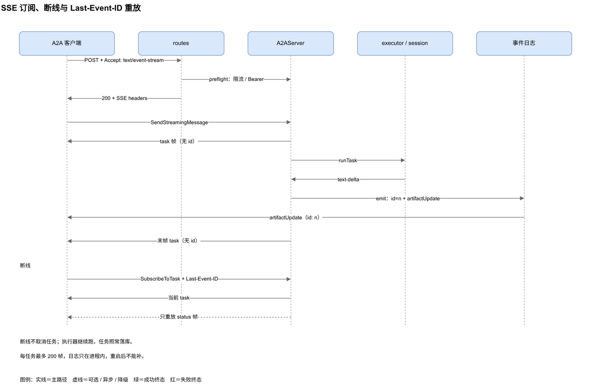
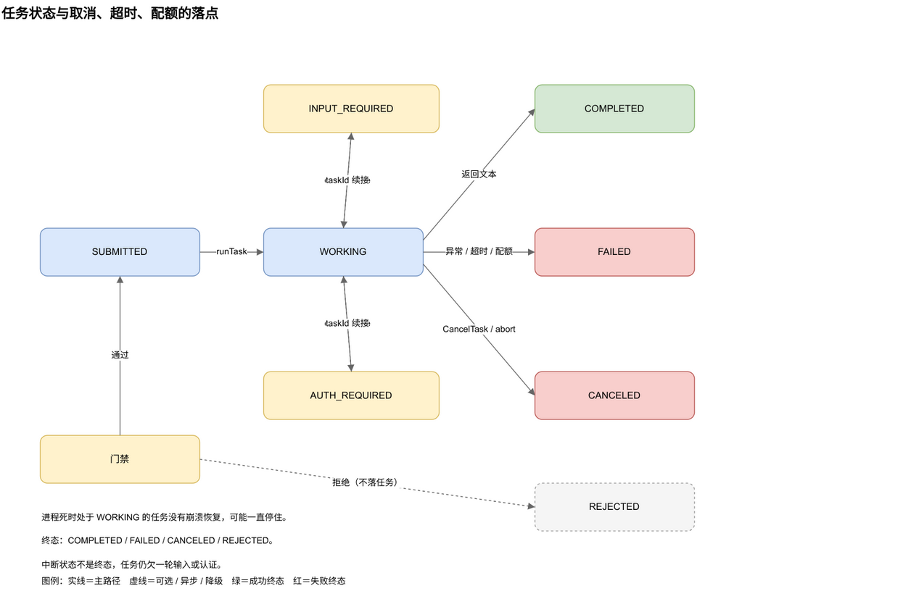
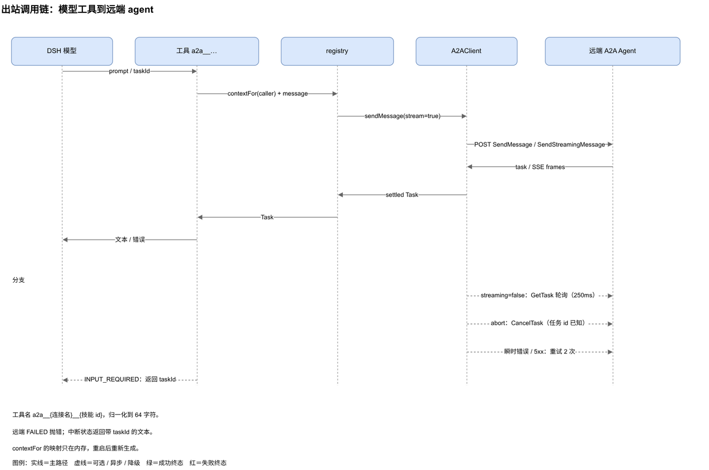

# 协议与接口

插件暴露两个互不相通的面：

1. 面板用的仅回环控制 API，基路径 `/a2a/api`；
2. 入站 server 发布的 A2A 端点，路径由实例的 `endpointPath` 决定，默认 `/a2a/<id>`。

远端 A2A 客户端可以调用第二个面，不能驱动第一个面。两个面共用同一个 web server，但鉴权模型不同。

---

## 1. 两个面与信任边界

| 面 | 谁调用 | 鉴权 | 请求体上限 |
|---|---|---|---|
| `/a2a/api` | 面板、脚本、测试 | 仅回环地址，`127.0.0.1`、`::1`、`::ffff:127.0.0.1` | 固定 1 MB |
| `/a2a/<id>` | 远端 A2A 客户端 | 可选每实例 Bearer token | `maxBodyBytes`，默认 1 MB |

`/a2a/api` 的非回环请求直接返回 `403`，把它放到反向代理后面也不会变成远程可调用。A2A 端点跟 GUI 共用 web server，把 web server 暴露到网络时要在每个入站实例上配 Bearer token，并在代理层终止 TLS。插件本身不加 TLS。

---

## 2. 面板 API

### 2.1 读接口

| 方法与路径 | 返回 |
|---|---|
| `GET /a2a/api` | 快照：`version`、`inbounds`、`outbounds`、`tasks`、`taskTotal`、`taskNextOffset`、`peers`、`sessions`、`metrics` |
| `GET /a2a/api/presets` | preset 名单：`[{ id, name?, description?, isDefault? }]` |
| `GET /a2a/api/update` | 插件版本与更新检查结果，`?refresh=1` 绕过缓存 |
| `GET /a2a/api/card?id=<inbound>` | 一个入站实例的 AgentCard，未知返回 `404` |
| `GET /a2a/api/task?id=<task>` | 一条任务记录，未知返回 `404` |
| `GET /a2a/api/session?contextId=<id>&serverId=<instance>` | 一个活上下文的派生对话消息，缺 `serverId` 且上下文有歧义时返回 `409` |
| `GET /a2a/api/metrics` | 指标快照 |

`GET /a2a/api/session` 是仅回环的调试视图，返回原始派生 DSH 消息，可能包含 reasoning block。它不属于 A2A 线协议；A2A 端点不会因此暴露 reasoning。

`GET /a2a/api` 支持 `taskLimit`（默认 50）、`taskOffset`、`taskState`、`taskContextId`、`taskServerId` 翻任务列表。任务按 `updatedAt` 倒序，`taskNextOffset` 为 `null` 表示没有下一页。

快照里的 `version` 是已安装插件版本，面板不用等更新检查就能显示。`inbounds[].cardUrl` 是卡片里 `supportedInterfaces` 宣告的端点 URL，卡片 JSON 本身在 `cardPath`；`inbounds[].trace` 是该实例**生效后**的 trace 策略（部署开关已经算进去），不是原始记录字段。`outbounds[].agentVersion` 是远端卡片宣告的版本，连接未建立时没有这个字段。

任务记录用插件自己的 `TaskRecord` 形状：`taskId`、`contextId`、`skill`、`state`、`createdAt`、`updatedAt`、`parts`、`artifacts`、`inputs`、`statusText`、`trace`、`serverId`、`messageIds` 等。A2A 端点返回的是协议 `Task`：`id`、`status`、`artifacts`、`history`、`metadata`。两套字段不要混用。

`GET /a2a/api/update` 的返回：

```json
{
  "ok": true,
  "current": "0.5.1",
  "latest": "0.5.2",
  "hasUpdate": true,
  "ahead": false,
  "error": null,
  "source": "npm",
  "repoUrl": "https://github.com/HanphoneJan/dsh-a2a",
  "packageName": "@hanphone/dsh-a2a",
  "checkedAt": 1790000000000,
  "cached": false,
  "runtime": { "node": "24.20.0", "platform": "linux", "arch": "x64", "profile": "web" }
}
```

检查同时问 npm registry 的 `latest` 标签和 `package.json` 里仓库的 GitHub `package.json`，取较高版本。缓存 6 小时，`refresh=1` 强制重查。两个来源都失败时仍返回 `200`，`ok` 为 `false`，`latest` 为 `null`，`error` 写原因。检查是只读的，不安装、不重启、不改 profile。

### 2.2 控制动作

`POST /a2a/api`，JSON body 里的 `action` 决定动作。

**入站**

| action | 必填 | 可选 |
|---|---|---|
| `inbound.create` | `name`、`description`、`version` | `endpointPath`、`preset`、`authTokenEnv`、`trace`、`enabled` |
| `inbound.update` | `id` | `name`、`description`、`version`、`endpointPath`、`preset`、`authTokenEnv`、`trace` |
| `inbound.remove` | `id` | 无 |
| `inbound.enable` / `inbound.disable` | `id` | 无 |
| `inbound.setAuth` | `id` | `token`，省略或空字符串表示清除 |
| `inbound.sendTest` | `id`、`text` | `contextId`、`skill` |
| `inbound.close` | `id`（对端 id） | 无 |

`inbound.sendTest` 走同一套门禁与任务生命周期，只跳过 HTTP 鉴权。它只存在于回环 API，不出现在 A2A 端点上。`trace` 是实例级策略；部署配置 `inboundTrace: false` 时，即使记录里写了 `true` 也不会生效。

**出站**

| action | 必填 | 可选 |
|---|---|---|
| `outbound.create` | `name`、`agentCardUrl` | `bearerTokenEnv`、`preset`、`enabled`、`timeoutMs`、`disabledSkills`、`skillOverrides` |
| `outbound.update` | `id` | `name`、`preset`、`timeoutMs`、`disabledSkills`、`skillOverrides` |
| `outbound.remove` | `id` | 无 |
| `outbound.enable` / `outbound.disable` | `id` | 无 |
| `outbound.refresh` | `id` | 无 |
| `outbound.setAuth` | `id` | `token`，省略或空表示清除 |
| `outbound.discover` | `agentCardUrl` | `token` |

`outbound.update` 不改 `agentCardUrl`。要换远端卡片，删掉连接再建一个新的。

**任务与会话**

| action | 必填 | 效果 |
|---|---|---|
| `task.cancel` | `id`（任务 id） | 中止并标记取消 |
| `session.cancel` | `id`（contextId） | 取消该上下文的活跃任务，会话保留，可选 `serverId` 限定实例 |
| `session.close` | `id`（contextId） | 取消活跃任务并释放该上下文的活会话句柄，可选 `serverId` |

### 2.3 返回与状态码

成功动作返回 `200`：

```json
{ "ok": true, "message": "inbound server \"reports\" created", "id": "reports-1a2b3c4d" }
```

`inbound.create` 与 `outbound.create` 带 `id`，`outbound.discover` 带 `preview`，里面有远端名称、版本、描述、端点与技能。动作失败返回 `409`，body 是 `{ "ok": false, "message": "...", ... }`。

| 状态 | 含义 |
|---|---|
| `200` | 读取或动作成功 |
| `400` | body 不是合法 JSON |
| `403` | 调用方不是回环地址 |
| `404` | 请求的卡片或任务不存在 |
| `405` | 方法不是 `GET` / `POST` |
| `409` | 动作失败，或会话上下文有歧义 |
| `413` | 请求体超过面板 API 的 1 MB 上限 |

### 2.4 示例

创建一个入站实例：

```sh
curl -sS -X POST http://127.0.0.1:3080/a2a/api \
  -H 'content-type: application/json' \
  -d '{
    "action": "inbound.create",
    "name": "reports",
    "description": "Reporting agent",
    "version": "0.1.0",
    "preset": "standard",
    "enabled": true
  }'
```

设置它的 Bearer token：

```sh
curl -sS -X POST http://127.0.0.1:3080/a2a/api \
  -H 'content-type: application/json' \
  -d '{ "action": "inbound.setAuth", "id": "reports-1a2b3c4d", "token": "s3cr3t" }'
```

只读远端卡片，不建连接：

```sh
curl -sS -X POST http://127.0.0.1:3080/a2a/api \
  -H 'content-type: application/json' \
  -d '{ "action": "outbound.discover", "agentCardUrl": "https://remote.example/a2a/x/agent-card.json" }'
```

建立连接：

```sh
curl -sS -X POST http://127.0.0.1:3080/a2a/api \
  -H 'content-type: application/json' \
  -d '{
    "action": "outbound.create",
    "name": "remote",
    "agentCardUrl": "https://remote.example/a2a/x/agent-card.json",
    "timeoutMs": 60000
  }'
```

---

## 3. A2A 端点、鉴权与版本

一个入站实例发布两条路由：

| 路径 | 方法 | 用途 |
|---|---|---|
| `/a2a/<id>/agent-card.json` | `GET` | AgentCard JSON |
| `/a2a/<id>` | `POST` | JSON-RPC 端点 |

端点路径是实例的 `endpointPath`，默认 `/a2a/<id>`。卡片路径是端点加 `/agent-card.json`。停用实例会同时注销两条路由。

没有 token 时不需要 `Authorization`。配置了 token 后，每个请求都要带：

```http
Authorization: Bearer <token>
```

缺失或错误返回 `401`，响应头带 `WWW-Authenticate: Bearer`。流式请求在写 `200` SSE 响应头之前完成鉴权，所以 `401` 仍然是普通 HTTP 状态，不会变成半个流。

token 在实例组装时解析。解析顺序是 credentials 服务，再是进程环境变量。面板写入的 token 存在凭据层，记录里只保留生成的变量名。

`A2A-Version` 可以放请求头，也可以放查询参数。只比较主次版本，`1.0.x` 都算兼容。不匹配时返回 JSON-RPC 错误 `VERSION_NOT_SUPPORTED`（`-32007`），HTTP 状态仍是 `200`，响应头带 `A2A-Version: 1.0`。

请求体超过 `maxBodyBytes` 时返回 `413`，读取失败返回 `400`。

---

## 4. 方法与消息

端点实现 A2A `1.0.1` 的 JSON-RPC 绑定，方法名是 PascalCase。

| 方法 | 参数 | 行为 |
|---|---|---|
| `SendMessage` | `message`、`configuration?` | 创建或续接任务，等到终态或中断后返回 `{ task }` |
| `SendStreamingMessage` | `message`、`configuration?` | 创建或续接任务并以 SSE 推帧，要求 `Accept: text/event-stream` |
| `GetTask` | `id`、`historyLength?` | 返回一条任务 |
| `ListTasks` | `contextId`、`status`、`pageSize`、`pageToken`、`statusTimestampAfter`、`includeArtifacts`、`historyLength` | 过滤、游标分页，按最近更新倒序，响应带 `totalSize` |
| `CancelTask` | `id` | 取消非终态任务，终态任务返回 `TASK_CANCEL_NOT_ALLOWED` |
| `SubscribeToTask` | `id` | 订阅非终态任务的流，终态任务返回 `UNSUPPORTED_OPERATION`，支持进程内 `Last-Event-ID` 重放 |
| `GetExtendedAgentCard` | 无 | 返回同一张 AgentCard |

未实现的方法返回 `METHOD_NOT_FOUND`。四个 push notification 配置方法返回 `PUSH_NOTIFICATION_NOT_SUPPORTED`（`-32003`），因为卡片宣告 `capabilities.pushNotifications: false`。

消息体：

```json
{
  "jsonrpc": "2.0",
  "id": "1",
  "method": "SendMessage",
  "params": {
    "message": {
      "messageId": "optional-uuid",
      "contextId": "optional-uuid",
      "role": "ROLE_USER",
      "parts": [{ "text": "hello" }],
      "metadata": { "skill": "chat" }
    }
  }
}
```

`parts` 可以是 text、file 或 data。text 与 data 直接进 DSH prompt，data 会被 JSON 序列化成文本。带 `raw` 的图片或文件在 attachments 服务挂载时走附件准入，换成持久引用。只有 `url` 的 file part 不下载，按文本处理。没有 attachments 服务时，原始附件退成可读占位符。

`metadata.skill` 选宣告过的技能，缺省是 `chat`。请求的技能不在宣告集合里，门禁会在执行前拒绝。

`contextId` 是对话键。复用同一个值会复用活会话，省略则生成新的。`messageId` 是幂等键，同一个 id 重发返回原任务，不跑第二轮。`taskId` 用来续接一个非终态且当前空闲的任务；这次输入会先追加进任务的可见历史，终态任务拒绝新消息，还在跑的任务返回 `UNSUPPORTED_OPERATION`。

`configuration` 有三个常用字段：

- `returnImmediately: true` 在任务启动后立刻返回，不等结算。
- `historyLength` 裁剪返回的历史消息条数，`0` 表示不返回，未设置表示不限制。`SendMessage` 与 `SendStreamingMessage` 都用它；`GetTask`、`ListTasks` 用自己的 `historyLength` 参数。
- `acceptedOutputModes` 只接受文本模式。请求里没有 `text/*`、`text/plain` 或 `*/*` 时返回 `CONTENT_TYPE_NOT_SUPPORTED`。

`Task.history` 是这次任务的 A2A 可见输入消息加最终输出（没有可见输出时是状态文本），不是 DSH 内部的完整 transcript。

---

## 5. 流式与重连



流式请求要带 `Accept: text/event-stream`，用 `curl -N` 看：

```sh
curl -N http://127.0.0.1:3080/a2a/<id> \
  -H 'content-type: application/json' \
  -H 'accept: text/event-stream' \
  -d '{
    "jsonrpc": "2.0",
    "id": "2",
    "method": "SendStreamingMessage",
    "params": { "message": { "role": "ROLE_USER", "parts": [{ "text": "hello" }] } }
  }'
```

每个 SSE 事件是一个 JSON-RPC 结果信封。状态帧与 artifact 帧带 `id:` 行，用于重连重放。首帧与末帧的任务快照不带 `id:`。

```text
id: 7
data: {"jsonrpc":"2.0","id":2,"result":{"artifactUpdate":{...}}}
```

首帧是当前 `task`，后面是 `statusUpdate` 与 `artifactUpdate`。artifact 块在追加时带 `append: true`，替换时带完整 artifact。错误用 JSON-RPC 错误信封。

`SubscribeToTask` 用同一套传输，先发当前任务，再流到任务结算。终态任务返回 `UNSUPPORTED_OPERATION`。带 `Last-Event-ID` 时，服务端先发当前快照，然后只重放状态帧，不重放 artifact 帧，避免追加块被应用两次。

流式路径只接受 `SendStreamingMessage` 与 `SubscribeToTask`。在 `Accept: text/event-stream` 下发 `SendMessage` 会收到一个 `METHOD_NOT_FOUND` 帧。反过来，`SendMessage` 只在非流式路径处理。

默认 `session` 执行器只把可见 assistant 文本增量写成 `result` artifact 下的 `artifactUpdate`，`lastChunk: false`，最后用 `lastChunk: true` 收尾。工具活动**不是** artifact；推理增量与工具结果都不投影。结算后的任务才是事实来源。

流的结构是：

1. 一个初始 `task` 帧，带当前状态、任务 id 与可用历史；
2. 零到多个 `artifactUpdate` 帧，只携带可见 assistant 文本；
3. 零到多个 `statusUpdate` 帧；激活可选扩展时可携带 trace metadata；
4. 一个最终 `task` 帧，带完整 artifact 集合与落定后的历史。

`configuration.historyLength` 同时裁剪首帧与末帧的任务历史快照。

默认只宣告并产生 text/plain 输出。没有可见文本的一轮以 `TASK_STATE_COMPLETED` 结束：不产生 `result` artifact，`status.message` 是 `The agent completed without visible output.`，并带 `metadata.reason = 'no-visible-output'`。它不是失败，也不会回退到 reasoning。

客户端断开不会取消任务。执行器继续跑，任务照常落库，SSE 只是投递。重连有两种做法：

- 从首帧拿到 `taskId`，用 `GetTask` 轮询；
- 用 `SubscribeToTask` 加 `Last-Event-ID` 从当前状态继续流。

状态帧与 artifact 帧的 `id:` 是进程内序号。每个任务最多保留 200 帧，日志只在本进程有效。重连到同一进程能补状态，重启后补不了。

`SubscribeToTask` 只投递任务已经产生的事件。trace 扩展在**启动任务**的请求上激活；对一个已经跑起来的任务再订阅，不会为它补开 trace。

`SendMessage` 的响应在断线时丢了，用同一个 `messageId` 重试，或者用 `ListTasks` 找回来。续接中断任务要带它的 `taskId`。复用 `contextId` 是延续对话，任务续接与对话连续是两件事。

进程重启保留任务与上下文绑定，不保留活会话与 SSE 订阅。进程死时处于 `TASK_STATE_WORKING` 的任务没有崩溃恢复，可能一直停在这个状态。

### 5.1 trace 扩展（可选）

实例策略允许时，AgentCard 的 `capabilities.extensions` 会宣告 `dsh-trace/v1`（见第 7 节）。客户端按请求激活：

```http
A2A-Extensions: https://github.com/hanphone/dsh-a2a/blob/main/docs/extensions/dsh-trace/v1.md
```

成功响应在同一个头里回显已激活的 URI。没请求扩展的客户端看不到任何变化。

实时观察放在 `TaskStatusUpdateEvent.metadata[URI]`：

```json
{
  "event": {
    "callId": "call-1",
    "tool": "read_file",
    "phase": "start",
    "status": "running",
    "argsPreview": "{\"path\":\"a.txt\"}",
    "timestamp": "2026-10-25T10:00:00.000Z"
  }
}
```

落定任务在 `Task.metadata[URI]` 里带一份有界摘要 `{ calls, truncated? }`。字段（`calls` 里的单条，以及摘要上的 `truncated`）：

| 字段 | 类型 | 含义 |
|---|---|---|
| `callId` | string | 工具调用关联 id |
| `tool` | string | 工具名 |
| `phase` | `start` / `end` | 观察阶段 |
| `status` | `running` / `ok` / `error` / `unknown` | `running` 只出现在 start；没有 result 就结束时为 `unknown` |
| `durationMs` | integer ≥ 0，可选 | 由会话事件时间计算的耗时 |
| `argsPreview` | string，可选 | 脱敏、截断后的参数摘要，只出现在 start |
| `timestamp` | ISO 8601 | 事件时间 |
| `truncated` | boolean，可选 | 摘要丢弃了更早的观察 |

边界：每任务最多 64 条观察；`argsPreview` 会把 token、secret、password、api-key、authorization、cookie、credential、private-key 等键脱敏，并把序列化值截断到 200 字符；无法解析的参数显示 `[unparseable arguments]`。trace 只走 metadata，永远不进入 artifact、history 或出站工具输出；`subagent` 执行器不观察子工具。任何能读任务的调用方都能看到 `Task.metadata` 里的摘要，所以只对可信对端开启。

---

## 6. 任务状态与错误码



| 状态 | 终态 | 含义 |
|---|---|---|
| `TASK_STATE_SUBMITTED` | 否 | 任务已记录，未开始 |
| `TASK_STATE_WORKING` | 否 | 执行器运行中 |
| `TASK_STATE_INPUT_REQUIRED` | 否，中断 | agent 需要更多输入 |
| `TASK_STATE_AUTH_REQUIRED` | 否，中断 | agent 需要认证 |
| `TASK_STATE_COMPLETED` | 是 | 完成；可能有 artifact，也可能因没有可见输出而没有 artifact |
| `TASK_STATE_FAILED` | 是 | 执行失败，状态消息带错误 |
| `TASK_STATE_CANCELED` | 是 | 调用方或面板取消 |
| `TASK_STATE_REJECTED` | 是 | 执行前被拒绝 |

入站路径实际产生 `SUBMITTED`、`WORKING`、`COMPLETED`、`FAILED`、`CANCELED`、`INPUT_REQUIRED`、`AUTH_REQUIRED`。`REJECTED` 在词表里，但门禁拒绝发生在建任务之前，所以不会有任务落在这个状态。

错误码：

| 码 | 名称 |
|---|---|
| `-32700` | `PARSE_ERROR` |
| `-32600` | `INVALID_REQUEST` |
| `-32601` | `METHOD_NOT_FOUND` |
| `-32602` | `INVALID_PARAMS` |
| `-32603` | `INTERNAL_ERROR` |
| `-32001` | `TASK_NOT_FOUND` |
| `-32002` | `TASK_CANCEL_NOT_ALLOWED` |
| `-32003` | `PUSH_NOTIFICATION_NOT_SUPPORTED` |
| `-32004` | `UNSUPPORTED_OPERATION` |
| `-32005` | `CONTENT_TYPE_NOT_SUPPORTED` |
| `-32006` | `STREAMING_NOT_SUPPORTED` |
| `-32007` | `VERSION_NOT_SUPPORTED` |
| `-32008` | `INVALID_AGENT_RESPONSE` |
| `-32040` | `UNAUTHORIZED`，映射 HTTP `401` |

实现会发出 `INVALID_REQUEST`、`INVALID_PARAMS`、`METHOD_NOT_FOUND`、`INTERNAL_ERROR`、`TASK_NOT_FOUND`、`TASK_CANCEL_NOT_ALLOWED`、`PUSH_NOTIFICATION_NOT_SUPPORTED`、`UNSUPPORTED_OPERATION`、`CONTENT_TYPE_NOT_SUPPORTED`、`VERSION_NOT_SUPPORTED` 与 `-32040`。

限流拒绝和流式门禁拒绝用 `-32000`。非流式门禁拒绝用 `INVALID_PARAMS`。并发配额与超时不返回 RPC 错误，直接把任务落 `FAILED`。

`PARSE_ERROR`、`STREAMING_NOT_SUPPORTED`、`INVALID_AGENT_RESPONSE` 在协议表里，入站分发器不发出它们。

---

## 7. AgentCard 与出站工具契约

AgentCard 是实例记录、对外 base URL 与端点路径的纯函数：

```json
{
  "name": "reports",
  "description": "Reporting agent",
  "version": "0.1.0",
  "provider": { "url": "https://deepseek.com", "organization": "DeepSeek" },
  "capabilities": {
    "streaming": true,
    "pushNotifications": false,
    "extendedAgentCard": true,
    "stateTransitionHistory": false,
    "extensions": [
      {
        "uri": "https://github.com/hanphone/dsh-a2a/blob/main/docs/extensions/dsh-trace/v1.md",
        "description": "Optional tool-call trace metadata. Disabled unless the client activates this extension.",
        "required": false,
        "params": {
          "carrier": "metadata",
          "default": "off",
          "args": "redacted-preview",
          "maxCalls": 64
        }
      }
    ]
  },
  "defaultInputModes": ["text/plain"],
  "defaultOutputModes": ["text/plain"],
  "skills": [{ "id": "chat", "name": "chat", "description": "..." }],
  "supportedInterfaces": [
    {
      "url": "http://127.0.0.1:3080/a2a/<id>",
      "protocolBinding": "JSONRPC",
      "protocolVersion": "1.0"
    }
  ]
}
```

`attachments` 服务挂载时，`defaultInputModes` 还会宣告 `image/png`、`image/jpeg`、`image/webp`、`image/gif` 与 `application/octet-stream`。配置 token 时卡片增加 `bearer` 安全方案与要求，绝不带 token 值。只有实例 trace 策略生效时，`capabilities.extensions` 才出现 `dsh-trace/v1`；它是可选项（`required: false`），通用客户端可以忽略。

卡片在实例的 `cardPath` 提供。实例不使用 `/.well-known/agent-card.json`，要用面板给出的完整 per-instance URL。



出站侧，每个启用的远端技能注册成一个模型工具：

```text
a2a__<connection-name>__<skill-id>
```

名字归一化到 `[A-Za-z0-9_-]`，截断到 64 字符，重名时追加短哈希。参数 schema：

```json
{
  "prompt": "The task or instruction to send to the remote agent.",
  "taskId": "Optional. Continue an interrupted remote task."
}
```

`prompt` 必填。工具用稳定的 per-caller `contextId` 发消息，远端卡片宣告流式时走 SSE，否则阻塞发送加轮询。调用方 abort 会传播，任务 id 已知时补发 `CancelTask`。传输错误与 5xx 最多重试 2 次。

远端任务 `TASK_STATE_FAILED` 时工具抛错，文本带远端消息。中断状态返回带 `taskId` 的文本：

```text
[remote agent TASK_STATE_INPUT_REQUIRED task=<id>] <message>
```

模型可以拿这个 id 再调一次。工具优先渲染远端任务的 `result` artifact（它的 parts 原样作为结果）；没有时只取其余可见 artifact 的**文本 part**。非 result artifact 的 `data` part 与 trace/诊断 artifact 不会被拼进模型可见结果。空结果返回 `(remote agent returned no output)`。

---

## 8. 当前限制与相关文件

`0.5.1` 的已知边界：

- `SendMessage` 默认阻塞到结算。`returnImmediately: true` 可以只启动就返回。历史消息是该任务的 A2A 可见输入与输出，不是完整逐轮记录。
- 只交付可见 assistant 文本；工具调用、工具结果与 reasoning 既不进 artifact，也不进 history。
- `acceptedOutputModes` 只接受文本，排除文本的请求得到 `CONTENT_TYPE_NOT_SUPPORTED`。
- 没有 push notification，四个配置方法返回 `PUSH_NOTIFICATION_NOT_SUPPORTED`。
- 只实现 JSON-RPC 绑定，没有 gRPC 与 HTTP+JSON。
- 没有 OAuth、mTLS 或按客户端凭据。限流是进程内、按来源地址，没有分布式配额或计费。
- SSE 事件日志在内存里，`Last-Event-ID` 只在同一进程的重连间有效。
- trace 是可选的、仅 metadata 且有界：每任务最多 64 条观察，参数摘要脱敏并截断到 200 字符。`subagent` 执行器的子工具不提供 trace。
- 出站 `preset` 是持久化元数据，没有从它组装本地衔接会话，工具直接调用远端。
- `subagent` 执行器存在，但默认技能表不选它。
- 进程死时处于 `TASK_STATE_WORKING` 的任务没有崩溃恢复。

| 文件 | 说明 |
|---|---|
| `src/api.ts` | 面板 API 路由与动作分发 |
| `src/server/a2a-server.ts` | JSON-RPC 方法、SSE、任务历史、扩展激活、状态与错误 |
| `src/server/trace.ts` | trace URI、脱敏、上限与摘要追加 |
| `src/protocol.ts` | 方法名、状态、错误码、扩展类型 |
| `src/server/card.ts` | AgentCard 组装与扩展宣告 |
| `src/outbound/tools.ts` | 出站工具命名、参数与结果选取 |
| `docs/extensions/dsh-trace/v1.md` | `dsh-trace/v1` 契约 |
| `tests/unit/a2a-server.spec.ts` | 方法、状态、history、空输出、扩展激活与流式断言 |
| `tests/unit/routes.spec.ts` | 路由、鉴权、请求体上限 |
| `tests/unit/calls.spec.ts` | 客户端发送、轮询、流式、重试 |
